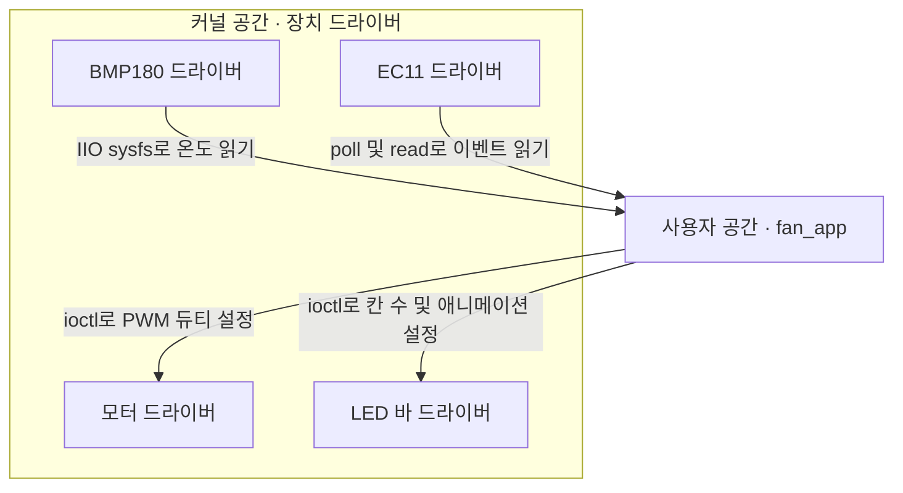
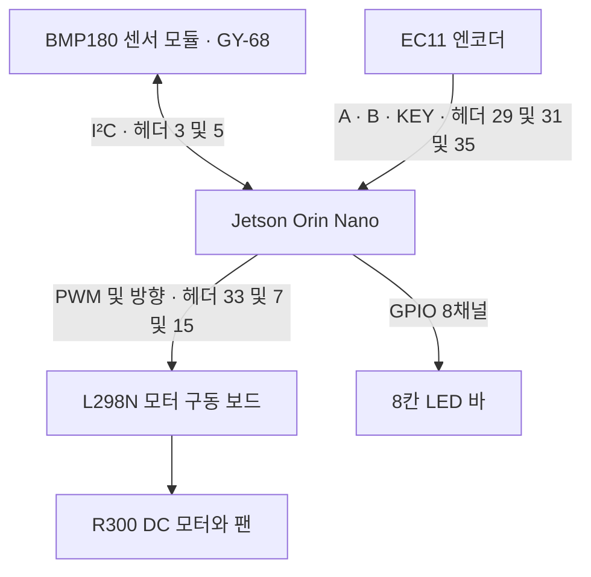
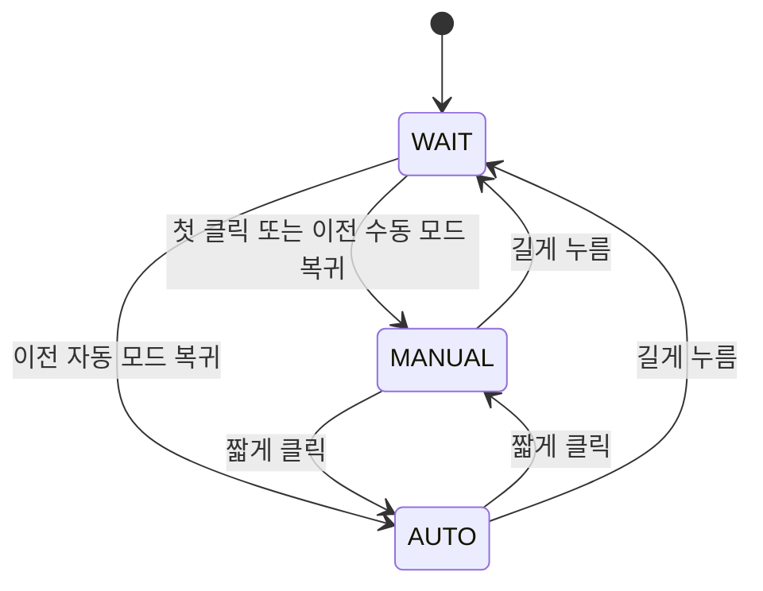
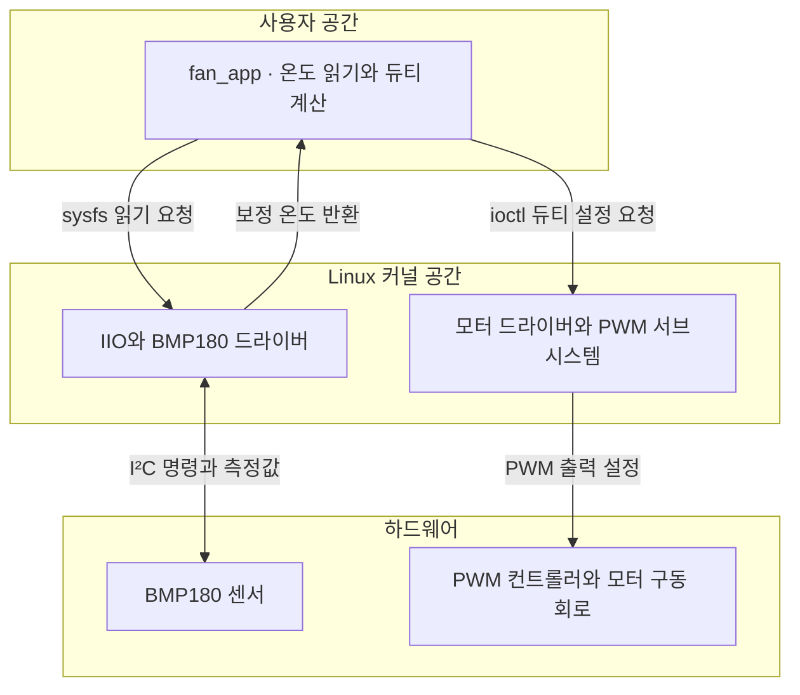
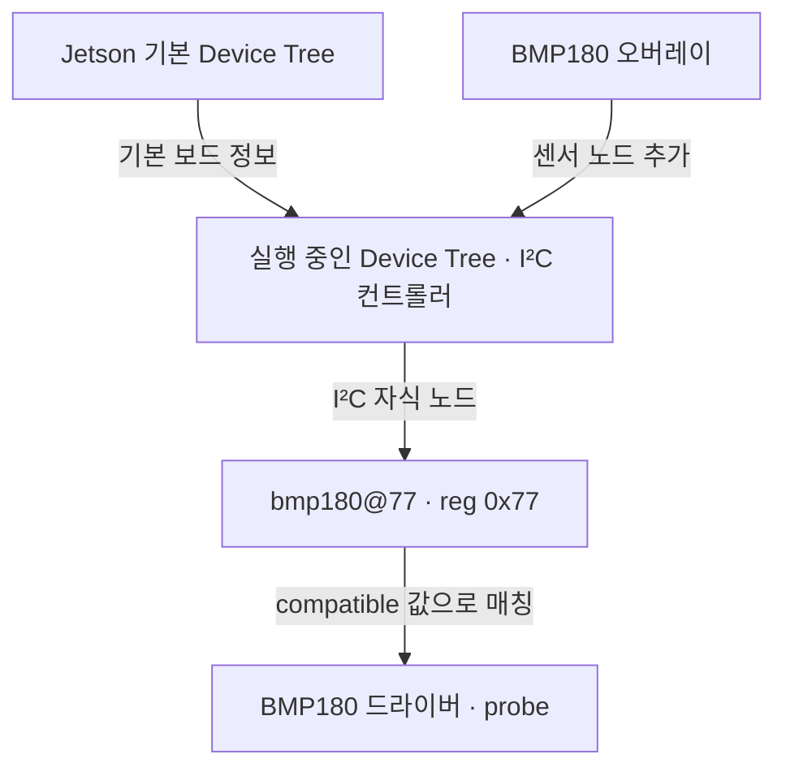
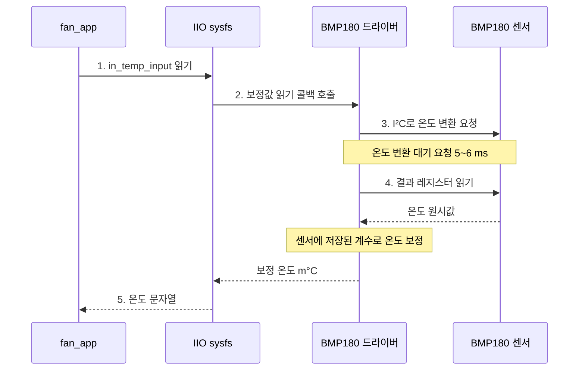
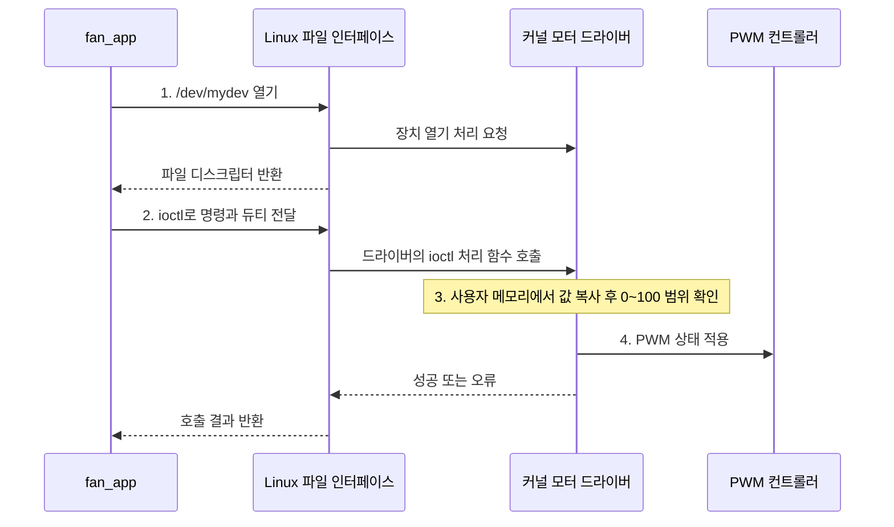
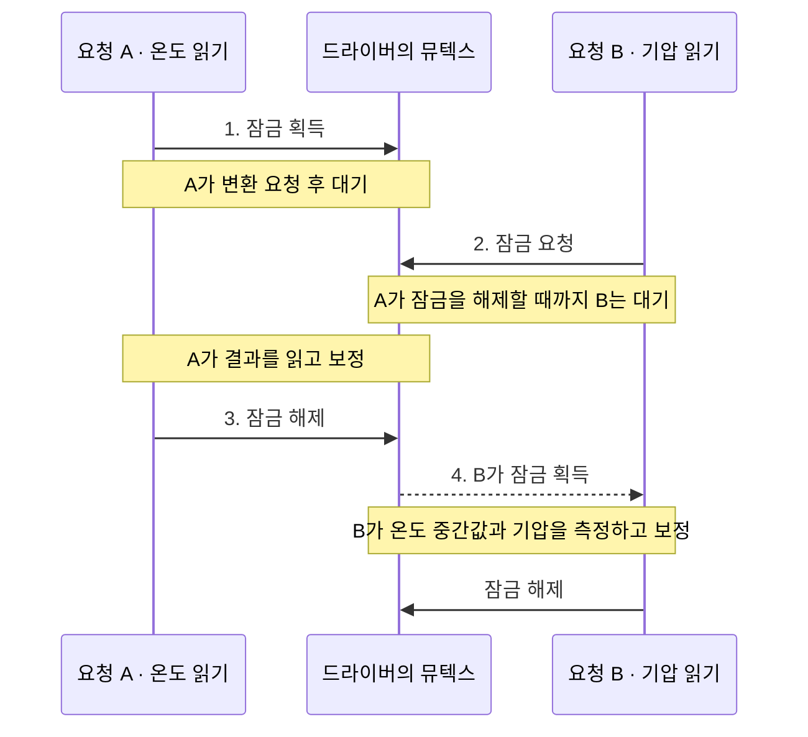
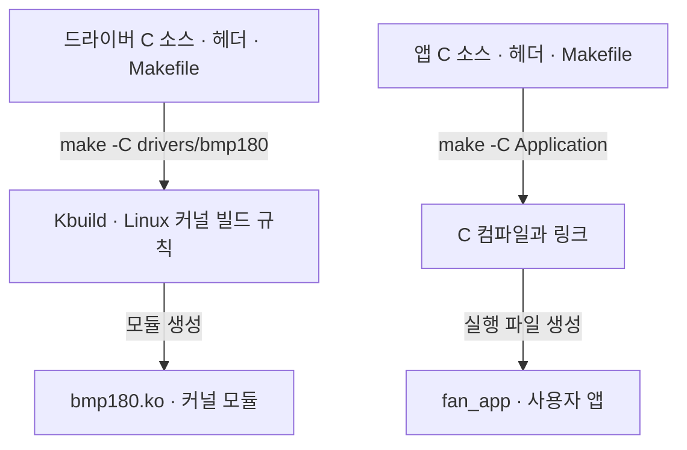

# 온도에 따라 풍량을 조절하는 Smart Fan

**수행 기간** · 2026.10.08 ~ 2026.10.13  
**기술 스택** · C, Linux 커널 모듈, Device Tree, GNU Make  
**개발 도구** · VS Code

Jetson Orin Nano에서 BMP180 센서로 온도를 측정하고, 측정값에 따라 DC 팬을 제어하는 Embedded Linux 팀 프로젝트입니다. PWM(펄스 폭 변조)은 반복 신호에서 활성 구간의 비율인 듀티를 바꿔 모터 구동을 조절하는 방식입니다. 사용자 공간 앱 `fan_app`은 EC11 로터리 엔코더 입력으로 자동·수동·대기 모드를 전환하고, 8칸 LED 바로 현재 상태를 표시합니다.

**담당 · 고지현** — BMP180 커널 드라이버 개발과 IIO(Industrial I/O)를 통한 센서 측정값의 사용자 앱 연동.

**소스 기준** · [`kobokdong/Thermal_Fan_Driver`의 `main` · `1c76e6f`](https://github.com/kobokdong/Thermal_Fan_Driver/tree/1c76e6f1a0d9e915cf661714f6876eab51e2cbd6)

## 목차

- [온도에 따라 풍량을 조절하는 Smart Fan](#온도에-따라-풍량을-조절하는-smart-fan)
  - [목차](#목차)
  - [시스템 구성](#시스템-구성)
  - [담당 역할](#담당-역할)
  - [실행 환경](#실행-환경)
    - [Device Tree에서 사용하는 연결](#device-tree에서-사용하는-연결)
  - [빌드 및 실행](#빌드-및-실행)
    - [Makefile이 빌드하는 대상](#makefile이-빌드하는-대상)
    - [1. 소스 내려받기와 빌드 · 최초 설치 또는 소스 변경 시](#1-소스-내려받기와-빌드--최초-설치-또는-소스-변경-시)
    - [2. Device Tree 오버레이 적용](#2-device-tree-오버레이-적용)
    - [3. 모듈 로드와 인터페이스 확인](#3-모듈-로드와-인터페이스-확인)
    - [4. 앱 시작 · 운전할 때마다](#4-앱-시작--운전할-때마다)
  - [모드와 제어 규칙](#모드와-제어-규칙)
  - [테스트와 검증](#테스트와-검증)
    - [모터 PWM 시험](#모터-pwm-시험)
    - [BMP180 실기 확인과 경계값 시험](#bmp180-실기-확인과-경계값-시험)
    - [일반 문제 해결](#일반-문제-해결)
    - [트러블슈팅 사례](#트러블슈팅-사례)
      - [GPIO를 제어해도 LED가 켜지지 않았던 문제](#gpio를-제어해도-led가-켜지지-않았던-문제)
      - [온도 경계에서 LED 칸 수가 반복해서 바뀌는 현상](#온도-경계에서-led-칸-수가-반복해서-바뀌는-현상)
  - [알려진 제약과 코드 개선점](#알려진-제약과-코드-개선점)
  - [요소기술](#요소기술)
    - [1. Linux 커널](#1-linux-커널)
    - [2. User Space와 Kernel Space](#2-user-space와-kernel-space)
    - [3. Device Tree](#3-device-tree)
    - [4. IIO](#4-iio)
    - [5. ioctl](#5-ioctl)
    - [6. Mutex](#6-mutex)
    - [7. Makefile](#7-makefile)
  - [코드 탐색](#코드-탐색)

## 시스템 구성

앱은 커널이 장치 정보를 파일처럼 보여주는 `sysfs`에서 온도를 읽습니다. 입력을 기다릴 때는 `poll()`, 장치별 제어 명령을 보낼 때는 `ioctl()`을 사용합니다.



*개념도 · 앱이 커널 드라이버에서 입력을 읽고 제어 요청을 보내는 경로입니다.*

| 구성 요소 | Linux 인터페이스 | 구현 |
| --- | --- | --- |
| [BMP180](drivers/bmp180/bmp180.c) | I²C, IIO sysfs | I²C(두 신호선으로 장치와 통신하는 방식)로 센서 ID와 보정 계수를 읽어 온도·기압 보정. `in_temp_input`은 m°C, `in_pressure_input`은 kPa로 제공 |
| [DC 모터](drivers/dc_motor/motor.c) | `/dev/mydev`, PWM, GPIO | Device Tree에서 PWM과 방향 GPIO를 가져오고 `MY_IOCTL_CMD_SET_PWM`으로 듀티 0~100% 설정 |
| [EC11](drivers/ec11/ec11.c) | `/dev/ec11`, GPIO 입력 | 핀 상태 변화에 따른 인터럽트로 회전·클릭·길게 누르기를 감지하고, 커널 큐 `kfifo`에 쌓인 이벤트를 `poll()`과 `read()`로 전달 |
| [LED 바](drivers/ledbar/ledbar.c) | `/dev/ledbar`, GPIO 배열 | 최대 8칸 표시 및 타이머 기반 애니메이션. 앱은 [LED 제어 코드](drivers/ledbar/ledbar_ctrl.c)를 통해 표시를 갱신 |
| [fan_app](Application/fan_app.c) | IIO sysfs, `poll()`, `ioctl()` | 모드 전환, 온도 샘플링, PWM 듀티 계산, 종료 시 모터 정지 요청 |

## 담당 역할

고지현은 BMP180 센서 드라이버 개발과 사용자 공간 앱 연동을 담당했습니다.

- [BMP180 드라이버](drivers/bmp180/bmp180.c)에서 I²C로 센서 ID와 EEPROM 보정 계수를 읽고, 원시값에 보정식을 적용해 온도·기압을 계산했습니다.
- 측정 명령 → 변환 대기 → 결과 읽기·보정 순서를 뮤텍스로 보호해 동시 IIO 읽기 요청이 센서 측정 순서를 섞지 않도록 했습니다.
- 보정값을 IIO sysfs로 제공하고 [`fan_app`](Application/fan_app.c)의 자동 모드에 온도 입력을 연동했습니다. 앱은 온도로 PWM 듀티를 계산하며, 읽기에 실패하면 0% 듀티를 요청합니다.

**확인 범위** · 기준 커밋에서 IIO 채널 등록, 온도·기압 반환 단위, 앱의 온도 입력 경로를 확인했습니다. Jetson에서의 실제 드라이버 등록과 IIO 읽기 결과는 [검증 상태](#테스트와-검증)에 표시했습니다.

## 실행 환경

- Jetson Orin Nano Developer Kit와 JetPack 6 계열의 Jetson Linux를 기준으로 합니다. 아래 명령은 Jetson의 Bash에서 실행합니다.
- 실행 중인 커널과 일치하는 커널 헤더 또는 빌드 트리, C 컴파일러, GNU Make, Device Tree Compiler(`dtc`)가 필요합니다. 드라이버 Makefile의 기본 커널 빌드 경로는 `/lib/modules/$(uname -r)/build`입니다.
- 주변 장치는 BMP180, EC11, PWM·방향 입력을 받는 모터 구동 회로와 DC 팬, 8칸 LED 바입니다. LED 바 초기화에 실패해도 앱은 온도 측정과 팬 제어를 계속합니다.

### Device Tree에서 사용하는 연결



*신호 연결도 · 팀 발표 자료 4~5번 슬라이드의 부품과 저장소 DTS의 연결을 바탕으로 그렸습니다. 물리 핀 번호는 아래 표와 함께 확인합니다.*

| 장치 | 저장소 오버레이 설정 |
| --- | --- |
| [BMP180](drivers/bmp180/bmp180-overlay.dts) | SDA 헤더 3번, SCL 5번. I²C 노드 `/bus@0/i2c@c250000`, 7비트 주소 `0x77` |
| [DC 모터](drivers/dc_motor/motor-overlay.dts) | 방향 IN1 헤더 7번, IN2 15번. PWM5 헤더 33번, 1 kHz |
| [EC11](drivers/ec11/ec11-overlay.dts) | A/B/KEY 헤더 29/31/35번, GPIO active-low |
| [LED 바](drivers/ledbar/ledbar-overlay.dts) | LED1→LED8 헤더 12/13/16/18/22/37/38/40번, GPIO active-high |

LED1을 예로 들면, **12번**은 보드에 선을 꽂는 위치, **63**은 DTS에서 GPIO를 지정하는 값, **50**은 기존 환경의 `gpiochip0`에서 조회한 라인 번호입니다.

| 신호 | 물리 헤더 | SoC 핀 이름 | DTS 지정값 | 기존 런타임 기록 |
| --- | --- | --- | --- | --- |
| LED1 | 12번 | `PH.07` | `<&gpio 63 0>` | `gpiochip0` 라인 50 |

대상 보드에서 `gpiodetect`로 GPIO 칩을 식별하고, `sudo gpioinfo | grep -F 'PH.07'`로 해당 칩의 라인과 핀 이름을 대조합니다. I²C 노드와 I²C·PWM·GPIO 핀 기능도 실제 구성에서 확인합니다. [LED full DTS](drivers/ledbar/ledbar-overlay.dts) · [핀 번호 기록](https://github.com/kobokdong/Thermal_Fan_Driver/blob/1c76e6f1a0d9e915cf661714f6876eab51e2cbd6/README.md#L86-L138) · [NVIDIA Jetson 확장 헤더 문서](https://docs.nvidia.com/jetson/archives/r36.5/DeveloperGuide/HR/ConfiguringTheJetsonExpansionHeaders.html)

## 빌드 및 실행

### Makefile이 빌드하는 대상

Makefile에는 생성할 대상, 필요한 소스·헤더, 실행할 빌드 명령이 들어 있습니다. `make -C <디렉터리>`는 해당 디렉터리의 Makefile을 실행합니다. 이 저장소에서는 커널 모듈과 사용자 공간 프로그램의 빌드 경로가 나뉩니다.

| Makefile | 동작 | 산출물 |
| --- | --- | --- |
| [드라이버 예시](drivers/bmp180/Makefile) | `obj-m`으로 외부 모듈을 지정합니다. `make -C <커널 빌드 경로> M=<드라이버 디렉터리> modules`로 커널의 빌드 시스템인 Kbuild를 호출합니다. | 드라이버 디렉터리의 `.ko` |
| [Application](Application/Makefile) | C 컴파일러로 `fan_app.c`와 `ledbar_ctrl.c`를 컴파일하고 링크합니다. | `Application/fan_app` |
| [Testbench](Testbench/Makefile) | 기본 타깃은 `ec11_test`, `ledbar_test`, `fan_ctrl`을 빌드합니다. `sim` 타깃은 `fan_led_sim`을 빌드합니다. | `Testbench/` 아래의 테스트 실행 파일 |

### 1. 소스 내려받기와 빌드 · 최초 설치 또는 소스 변경 시

```bash
git clone --branch main https://github.com/kobokdong/Thermal_Fan_Driver.git
cd Thermal_Fan_Driver
git checkout --detach 1c76e6f1a0d9e915cf661714f6876eab51e2cbd6
git rev-parse --short HEAD

head -n 1 /etc/nv_tegra_release
uname -r
test -f "/lib/modules/$(uname -r)/build/Makefile"
```

커밋, Jetson Linux 릴리스, 커널 버전을 실기 시험 결과와 함께 기록합니다. 마지막 명령이 실패하면 실행 커널과 일치하는 빌드 환경을 준비합니다. 이후 명령은 저장소 루트에서 실행합니다.

```bash
make -C drivers/bmp180
make -C drivers/dc_motor modules
make -C drivers/ec11
make -C drivers/ledbar
make -C Application
```

각 드라이버 디렉터리에 `bmp180.ko`, `motor.ko`, `ec11.ko`, `ledbar.ko`가 생성되고, 앱은 `Application/fan_app`으로 빌드됩니다.

### 2. Device Tree 오버레이 적용

최초 설정 또는 오버레이 변경 시 진행합니다.

```bash
tr '\0' '\n' < /proc/device-tree/compatible
```

BMP180·모터·EC11 오버레이는 `nvidia,p3768-0000+p3767-0005-super`를 대상으로 작성됐습니다. 실제 보드의 `compatible`, 기본 DTB의 `gpio`·`pwm5` 심볼, I²C 대상 노드와 헤더의 핀 기능을 대조합니다.

| LED 오버레이 | 선택 조건 | 빌드 결과 |
| --- | --- | --- |
| [full](drivers/ledbar/ledbar-overlay.dts) | `pinctrl`을 오버레이에 포함합니다. 기본 DTB의 `pinmux` 심볼을 확인하고, Super 보드에서 사용하려면 루트 `compatible`에 실제 보드 문자열을 추가합니다. | `make -C drivers/ledbar dtbo` → `drivers/ledbar/ledbar.dtbo` |
| [simple](drivers/ledbar/ledbar-simple-overlay.dts) | Super 보드 문자열이 들어 있습니다. LED 핀의 GPIO 출력 기능과 핀 설정은 Jetson-IO 등으로 별도 확인합니다. | 아래 `dtc` 명령 → `drivers/ledbar/ledbar-simple.dtbo` |

두 오버레이 모두 `/ledbar` 노드를 정의합니다. 부팅 항목에는 선택한 LED DTBO 하나를 등록합니다. [저장소의 핀 설정·DTBO 절차](https://github.com/kobokdong/Thermal_Fan_Driver/blob/1c76e6f1a0d9e915cf661714f6876eab51e2cbd6/README.md#L364-L393)

먼저 BMP180·모터·EC11의 DTBO를 만듭니다.

```bash
dtc -@ -I dts -O dtb -o drivers/bmp180/bmp180.dtbo drivers/bmp180/bmp180-overlay.dts
dtc -@ -I dts -O dtb -o drivers/dc_motor/motor.dtbo drivers/dc_motor/motor-overlay.dts
dtc -@ -I dts -O dtb -o drivers/ec11/ec11.dtbo drivers/ec11/ec11-overlay.dts
```

위 세 명령의 성공을 확인한 뒤, 같은 Bash에서 선택한 LED 빌드 블록 하나를 실행합니다.

**full**

```bash
unset ledbar_dtbo
make -C drivers/ledbar dtbo && ledbar_dtbo=drivers/ledbar/ledbar.dtbo
```

**simple**

```bash
unset ledbar_dtbo
dtc -@ -I dts -O dtb -o drivers/ledbar/ledbar-simple.dtbo \
    drivers/ledbar/ledbar-simple-overlay.dts && ledbar_dtbo=drivers/ledbar/ledbar-simple.dtbo
```

```bash
test -f "${ledbar_dtbo:-}" && sudo cp drivers/bmp180/bmp180.dtbo drivers/dc_motor/motor.dtbo \
    drivers/ec11/ec11.dtbo "$ledbar_dtbo" /boot/
```

`/boot/extlinux/extlinux.conf`에서 사용할 부팅 항목의 `FDT`가 보드에 맞는 DTB를 가리키는지 확인합니다. 같은 항목의 `OVERLAYS`에 DTBO를 추가한 뒤 해당 항목으로 재부팅합니다. 이전 LED DTBO 경로가 있으면 선택한 경로로 교체하고, 다른 장치에 필요한 오버레이는 쉼표로 이어 둡니다. 아래는 full을 선택한 예입니다. simple을 선택했다면 마지막 경로에 `/boot/ledbar-simple.dtbo`를 사용합니다. [NVIDIA 오버레이 문서](https://docs.nvidia.com/jetson/archives/r36.5/DeveloperGuide/HR/JetsonModuleAdaptationAndBringUp/JetsonOrinNxNanoSeries.html#device-tree-overlays) · [여러 DTBO 경로 지정 예시](https://forums.developer.nvidia.com/t/multiple-device-overlays/313975)

```text
OVERLAYS /boot/bmp180.dtbo,/boot/motor.dtbo,/boot/ec11.dtbo,/boot/ledbar.dtbo
```

재부팅 후 실행 중인 Device Tree에 장치 노드가 생겼는지 확인합니다.

```bash
ls -d /proc/device-tree/bus@0/i2c@c250000/bmp180@77 \
    /proc/device-tree/motor /proc/device-tree/ec11 /proc/device-tree/ledbar
```

### 3. 모듈 로드와 인터페이스 확인

모듈을 아래 방식으로 수동 로드했다면 재부팅 후 이 단계부터 진행합니다.

```bash
sudo insmod drivers/bmp180/bmp180.ko
sudo insmod drivers/dc_motor/motor.ko
sudo insmod drivers/ec11/ec11.ko
sudo insmod drivers/ledbar/ledbar.ko

ls -l /dev/mydev /dev/ec11
for dev in /sys/bus/iio/devices/iio:device*; do
    [ -r "$dev/name" ] || continue
    [ "$(cat "$dev/name")" = bmp180_custom ] || continue
    printf '%s\n' "$dev"
    cat "$dev/in_temp_input" "$dev/in_pressure_input"
done
```

| 인터페이스 | 필요한 시점 |
| --- | --- |
| `/dev/mydev`, `/dev/ec11` | 앱 시작에 필요합니다. 앱은 시작할 때 모터에 0% 듀티 설정도 요청합니다. |
| `bmp180_custom` IIO 장치 | `AUTO` 모드의 온도 기반 제어에 필요합니다. |
| `/dev/ledbar` | LED 표시 기능에 필요합니다. LED 바 초기화에 실패해도 앱은 실행됩니다. |

**LED DT 바인딩 확인** — 노드가 존재하는지, 드라이버의 `probe()`가 완료됐는지, 장치 파일이 생성됐는지 순서대로 확인합니다.

```bash
test -d /proc/device-tree/ledbar && printf '%s\n' 'LED DT node present'
ls -l /sys/bus/platform/devices/ledbar/driver
sudo dmesg | grep -i ledbar
ls -l /dev/ledbar
```

`driver` 심볼릭 링크의 대상은 `/sys/bus/platform/drivers/ledbar`입니다. 로그에서 LED 바 준비 메시지와 `/dev/ledbar`를 확인합니다. 노드가 없다면 실제 부팅 항목과 오버레이 경로부터, 노드는 있고 바인딩이 없으면 장치 `compatible`·GPIO 자원·`probe()` 오류부터 확인합니다. [LED 장치 매칭과 등록](drivers/ledbar/ledbar.c)

IIO 이름이 `bmp180_custom`인 장치에서 온도와 기압을 읽을 수 있어야 합니다. 예를 들어 온도 값 `25000`은 25.0 °C입니다. 앱의 [`TEMP_PATH`](Application/fan_app.h)는 `iio:device0`을 사용합니다. BMP180이 다른 번호로 등록되면 찾은 경로로 `TEMP_PATH`를 바꾼 뒤 `make -C Application`을 다시 실행합니다.

### 4. 앱 시작 · 운전할 때마다

```bash
sudo ./Application/fan_app
```

`Fan Application Started`와 `[MODE] WAIT`가 표시되면 엔코더 버튼을 짧게 눌러 시작합니다. `-s <듀티 단계>`로 수동 모드의 회전 한 칸당 변화량을 1~100%p 범위에서 설정할 수 있습니다. 회전 방향이 반대로 느껴지면 `-r` 옵션을 사용합니다. `Ctrl+C`로 종료하면 앱이 모터 듀티를 0%로 설정하고 열린 장치를 닫습니다.

## 모드와 제어 규칙



*개념도 · 엔코더 버튼으로 운전 모드를 전환하는 흐름입니다.*

| 모드 | 동작 |
| --- | --- |
| `WAIT` | 모터 듀티를 0%로 설정하고 대기합니다. |
| `MANUAL` | 다이얼 한 칸당 기본 5%p씩 듀티를 바꿉니다. 범위는 0~100%입니다. |
| `AUTO` | 약 1초 간격으로 온도를 읽어 모터 듀티를 결정합니다. |

- **팬 기동·정지 히스테리시스** — 22 °C 이상에서 켜고 20 °C 미만에서 끕니다. 20 °C 이상 22 °C 미만에서는 이전 ON/OFF 상태를 유지해 반복 기동을 줄입니다.
- **AUTO PWM 듀티** — 팬이 켜진 상태에서 22 °C 이하는 40%, 22~32 °C는 40~100% 선형 증가, 32 °C 이상은 100%입니다. 40%는 코드의 최소 듀티 설정값이며, 해당 듀티에서의 실제 기동 여부는 실기 확인 항목입니다.
- **LED 표시 히스테리시스** — `AUTO`에서는 온도를 0~8칸으로 표시합니다. 기준 경계는 첫 칸 21 °C부터 마지막 칸 28 °C까지 1 °C 간격이며, 각 경계에 ±0.2 °C의 폭을 둬 표시 흔들림을 줄입니다. `MANUAL`에서는 듀티를 0~8칸으로 표시하고, `WAIT`에서는 LED를 끕니다.

동작 중 짧게 클릭하면 `MANUAL`과 `AUTO`가 전환되고, 기본 2초 동안 누르면 `WAIT`로 돌아갑니다. `WAIT`에서 클릭하면 이전 모드로 복귀합니다. 수동 듀티와 자동 제어의 ON/OFF 상태는 모드 전환을 거쳐 유지됩니다. `AUTO`로 복귀하면 온도를 새로 읽습니다. 예를 들어 직전 `AUTO`에서 팬이 켜져 있었고 복귀 후 새 온도가 21 °C라면, 코드상 40% 듀티로 다시 구동됩니다.

`AUTO`에서 온도를 읽지 못하면 `BMP180 read failed`를 출력하고 자동 제어 상태를 OFF로 초기화합니다. 직전에 모터가 동작 중이었다면 0% 듀티를 요청합니다. LED 바는 마지막 온도를 표시할 수 있습니다. 이후 온도 읽기가 복구되면 OFF 상태의 기동 기준인 22 °C를 다시 적용합니다.

## 테스트와 검증

```bash
make -C Testbench
make -C Testbench sim
```

**단독 테스트 실행 순서** · `fan_app`을 종료한 뒤 단독 테스트를 하나씩 실행합니다. 시험 프로그램을 종료한 뒤 `fan_app`을 다시 실행합니다. EC11 장치를 열면 공유 이벤트 큐가 비워지고, 둘 이상의 프로세스가 읽으면 이벤트를 나눠 소비할 수 있습니다. 모터 시험 앱이 `/dev/mydev`를 닫으면 드라이버가 모터 정지를 요청합니다. [EC11 큐 처리](https://github.com/kobokdong/Thermal_Fan_Driver/blob/1c76e6f1a0d9e915cf661714f6876eab51e2cbd6/drivers/ec11/ec11.c#L276) · [모터 close 처리](https://github.com/kobokdong/Thermal_Fan_Driver/blob/1c76e6f1a0d9e915cf661714f6876eab51e2cbd6/drivers/dc_motor/motor.c#L324)

| 검증 대상 | 명령 또는 조작 | 기대 결과 |
| --- | --- | --- |
| LED 예제의 온도 변환 | `./Testbench/ledbar_test temp 25` | 예제 규칙에서 25.0 °C에 3칸 출력. 장치 없이 확인 가능 |
| EC11 이벤트 | `sudo ./Testbench/ec11_test E` | 회전·클릭·길게 누르기 이벤트 출력 |
| LED GPIO 출력 | `sudo ./Testbench/ledbar_test level 4` | 실제 LED 바 아래부터 4칸 점등. 확인 후 `sudo ./Testbench/ledbar_test off` |
| 통합 앱과 같은 LED 표시 정책 | `sudo ./Testbench/fan_led_sim` | 모의 온도·다이얼 입력으로 실제 `/dev/ledbar` 출력 변화 확인 |
| EC11·LED 연동 시험 | `sudo ./Testbench/fan_ctrl -n` | `/dev/ec11`로 상태·듀티 표시를 확인하고, `/dev/ledbar`가 있으면 LED 바 동작도 확인합니다. `-n`은 별도 모드 LED를 끕니다. [`ops_set_pwm()`](https://github.com/kobokdong/Thermal_Fan_Driver/blob/1c76e6f1a0d9e915cf661714f6876eab51e2cbd6/Testbench/fan_ctrl.c#L100-L104)는 TODO 상태이므로 모터 출력은 아래 시험에서 확인합니다. |
| 실제 모터 제어 | [모터 PWM 시험](#모터-pwm-시험)의 `apptest` 또는 통합 앱 `fan_app` | PWM 출력, 모터 회전 및 장치 종료 후 정지를 확인합니다. |
| 전체 모드 전환 | 앱 실행 후 클릭 → 다이얼 회전 → 클릭 → 길게 누르기 | `WAIT → MANUAL → AUTO → WAIT`. 수동 듀티 변경, 자동 모드 온도·듀티 출력, 대기 진입 후 정지 확인 |

### 모터 PWM 시험

최종 Device Tree 설정에서 모터 드라이버가 연결되고 `/dev/mydev`가 생성된 상태로 진행합니다. `fan_app`을 종료한 뒤 각 입력을 독립적으로 시험합니다.

```bash
ls -l /sys/bus/platform/devices/motor/driver /dev/mydev
make -C drivers/dc_motor apptest APP_CC=cc
for duty in 0 40 70 100; do
    sudo ./drivers/dc_motor/apptest "$duty" || break
done
```

0%는 즉시 종료됩니다. 나머지 입력에서는 Enter를 누르기 전에 헤더 **33번 PWM**을 측정하고 회전을 관찰합니다. Enter를 누른 뒤 장치가 닫히고 팬이 정지하는지도 확인합니다. 아래 수치는 드라이버의 1 ms 주기 설정에서 계산한 **기대값**입니다. [PWM 설정과 정지 코드](drivers/dc_motor/motor.c) · [PWM5 설정](drivers/dc_motor/motor-overlay.dts)

| 요청 듀티 | 헤더 33번에서 확인할 기대 동작 | 모터 판정 |
| --- | --- | --- |
| 0% | PWM 비활성화 요청 후 구동 펄스 정지 확인 | 정지 |
| 40% | 주기 약 1 ms, 활성 구간 약 0.40 ms | 실제 회전 및 최소 듀티에서 기동 가능한지 확인 |
| 70% | 주기 약 1 ms, 활성 구간 약 0.70 ms | 실제 회전 확인 |
| 100% | 활성 상태 연속 출력 확인 | 실제 회전 확인 |
| Enter로 종료 | 장치가 닫힌 뒤 구동 펄스 정지 확인 | 정지 |

| 날짜·커밋 | Jetson Linux·커널 | 입력 | 측정 주기·활성 시간 또는 출력 상태 | 회전·정지 | 로그·파형 및 판정 |
| --- | --- | --- | --- | --- | --- |
| 미기록 | 미기록 | 0 / 40 / 70 / 100% 및 종료 | 측정 대기 | 확인 대기 | 실기 미검증 |

### BMP180 실기 확인과 경계값 시험

드라이버 로드 후 `sudo dmesg | grep -i bmp180`으로 등록 메시지를 확인하고, [IIO 확인 단계](#3-모듈-로드와-인터페이스-확인)에서 장치 이름과 온도·기압 읽기 결과를 함께 기록합니다. 앱 연동을 확인할 때는 같은 실행에서 `AUTO` 모드의 온도와 듀티 로그를 대조합니다.

| 입력 또는 조건 | 코드상 기대 동작 |
| --- | --- |
| AUTO가 꺼진 상태에서 21 → 22 → 21 °C | 듀티 0% → 40% → 40% |
| 팬이 켜진 상태에서 20 °C와 20 °C 미만 | 20 °C에서 40% 유지, 20 °C 미만에서 0% |
| 운전 중 센서 읽기 실패 후 정상 읽기 복구 | 실패 로그와 0% 듀티 요청 확인. 복구 후 22 °C 이상에서 기동 |

입력 온도를 제어하거나 읽기 실패를 재현할 수 있는 시험 환경에서 위 조건을 적용합니다. 표의 값은 코드에 따른 기대 동작입니다.

| 검증 구분 | 이번 문서의 확인 범위 |
| --- | --- |
| 실행 확인 · 빌드 명령 드라이런 | 기준 커밋의 앱·테스트·LED full DTBO Makefile에서 GNU Make의 `-n`으로 호출 명령과 산출물 이름을 확인했습니다. |
| 소스·설정 확인 | Device Tree 매칭, IIO 채널·단위, ioctl 명령, 모드 전환·온도 임계값, Makefile 타깃을 기준 커밋과 대조했습니다. |
| 기존 실행 기록 · LED 출력 성공 | 기존 Jetson Linux R36.5 / Linux 5.15 환경에서 `Jetson-IO + nodt=1` 경로로 LED 출력이 동작한 기록이 있습니다. [기존 LED 시험 기록](https://github.com/kobokdong/Thermal_Fan_Driver/blob/1c76e6f1a0d9e915cf661714f6876eab51e2cbd6/README.md#L469-L514) |
| 기존 실패 기록 · LED DT 적용 | 오버레이 적용 후 `/proc/device-tree/ledbar`가 생성되지 않았습니다. 최종 DT 적용 실패의 원인은 미확인입니다. [기존 검증 표](https://github.com/kobokdong/Thermal_Fan_Driver/blob/1c76e6f1a0d9e915cf661714f6876eab51e2cbd6/README.md#L495-L514) |
| 실기 확인 필요 | 기준 커밋의 BMP180 IIO 등록·읽기, 최종 DT 바인딩, 모터 PWM·회전·정지, 네 장치 동시 동작, 경계값·오류 복구 시험 |

### 일반 문제 해결

- **모듈을 로드할 수 없을 때** — `uname -r`과 `modinfo -F vermagic <모듈 경로>`를 대조합니다. `insmod` 오류의 세부 원인은 `sudo dmesg | tail -n 60`에서 확인합니다.
- **모듈 로드 후 장치가 없을 때** — 부팅 항목의 오버레이 경로와 보드 `compatible`을 확인하고, 커널 로그에서 드라이버의 `probe` 메시지를 확인합니다. 모터 PWM이 출력되지 않거나 LED가 켜지지 않으면 헤더 핀의 `pinmux`도 확인합니다.
- **앱에서 온도를 못 읽을 때** — `bmp180_custom` 등록 여부, `in_temp_input` 읽기 결과, 앱에 설정된 `TEMP_PATH` 순서로 확인합니다.

### 트러블슈팅 사례

#### GPIO를 제어해도 LED가 켜지지 않았던 문제

팀은 Jetson Linux R36.5에서 핀 설정을 조회해 LED용 헤더 핀이 `tristate` 상태여서 출력이 꺼져 있는 것을 확인했습니다. Jetson-IO에서 해당 헤더 핀을 GPIO로 설정했고, `nodt=1` 대체 경로에서 LED가 동작한 기록을 남겼습니다. `nodt=1`은 드라이버가 GPIO 라인 번호로 테스트 장치를 직접 만드는 방식입니다. [LED full DTS의 핀 설정 기록](drivers/ledbar/ledbar-overlay.dts) · [기존 시험 기록](https://github.com/kobokdong/Thermal_Fan_Driver/blob/1c76e6f1a0d9e915cf661714f6876eab51e2cbd6/README.md#L469-L514)

같은 증상을 진단할 때는 대상 커널에서 `pinconf-groups` 위치를 확인하고 LED 핀의 `tristate` 설정을 조회합니다. 아래 경로는 기존 R36.5 환경의 조회 예입니다.

```bash
sudo grep -A4 -E 'soc_gpio41_ph7|spi3_sck_py0' \
    /sys/kernel/debug/pinctrl/2430000.pinmux/pinconf-groups
```

대체 경로를 시험하려면 앱을 종료하고 DT 기반 LED 장치를 적용하지 않은 부팅 구성에서 진행합니다. Jetson-IO의 GPIO 설정을 적용한 뒤 `gpiodetect`와 `gpioinfo`로 칩과 라인 번호를 확인합니다. 이미 `ledbar` 모듈을 로드했다면 `sudo rmmod ledbar`로 해제한 뒤 아래 명령을 실행합니다. 기본 `chip`·`lines`와 실제 배선이 맞는지 확인합니다. [드라이버의 모듈 매개변수](drivers/ledbar/ledbar.c)

```bash
sudo insmod drivers/ledbar/ledbar.ko nodt=1
sudo ./Testbench/ledbar_test level 4
sudo ./Testbench/ledbar_test off
```

별도의 DT 적용 시도에서는 `/proc/device-tree/ledbar`가 생성되지 않았습니다. **최종 DT 적용 실패의 원인은 미확인**입니다. 재시험할 때 [오버레이 선택과 적용](#2-device-tree-오버레이-적용)과 [DT 바인딩 확인](#3-모듈-로드와-인터페이스-확인) 순서로 점검합니다.

#### 온도 경계에서 LED 칸 수가 반복해서 바뀌는 현상

- **문제** — 팀 통합 중 자동 모드에서 온도가 표시 단계의 경계값을 오갈 때 LED가 인접한 두 칸 수 사이에서 반복 전환됐습니다.
- **원인** — 상승과 하강에 같은 경계값을 적용하면 작은 온도 변화에도 표시 단계가 바뀝니다.
- **해결** — [`ledbar_temp_to_level()`](drivers/ledbar/ledbar_ctrl.c)에 ±0.2 °C 히스테리시스를 적용했습니다. 직전 표시 단계를 기억하고, 상승할 때와 하강할 때 서로 다른 온도에서 표시를 바꾸도록 했습니다.
- **검증 방법** — LED 바가 연결된 Jetson에서 `sudo ./Testbench/fan_led_sim`을 실행합니다. [테스트 코드](Testbench/fan_led_sim.c)가 입력 온도를 올렸다 내릴 때, 같은 두 표시 단계 사이의 전환 온도가 방향에 따라 달라지는지 출력 로그로 확인합니다. 3칸과 4칸의 기준 경계인 24 °C를 예로 들면, 코드상 3→4칸은 약 24.2 °C 이상, 4→3칸은 약 23.8 °C 미만에서 전환됩니다.

## 알려진 제약과 코드 개선점

| 현재 동작 | 영향 및 개선 방향 |
| --- | --- |
| [`TEMP_PATH`](https://github.com/kobokdong/Thermal_Fan_Driver/blob/1c76e6f1a0d9e915cf661714f6876eab51e2cbd6/Application/fan_app.h#L29)가 `iio:device0`을 고정해서 읽습니다. | 같은 속성을 제공하는 다른 센서가 먼저 등록되면 앱이 그 센서의 온도를 사용할 수 있습니다. 실행 시 IIO 장치 이름으로 `bmp180_custom`을 찾아 경로를 결정하고, 장치를 찾을 수 없는 경우를 처리하는 것이 개선 과제입니다. |
| [앱 실행 중 오류 경로](https://github.com/kobokdong/Thermal_Fan_Driver/blob/1c76e6f1a0d9e915cf661714f6876eab51e2cbd6/Application/fan_app.c#L385)가 정리 코드로 이어진 뒤 `EXIT_SUCCESS`를 반환할 수 있습니다. | 외부 스크립트가 정상 종료와 장치 오류를 구분하기 어렵습니다. 모터 정지와 장치 정리를 공통으로 수행하고, 종료 원인에 맞는 반환값을 전달하는 것이 개선 과제입니다. |

## 요소기술

이 절은 운영체제와 드라이버를 처음 배우는 독자를 위한 설명입니다. 먼저 앱·커널·장치의 관계를 보고, 이어서 센서 읽기와 모터 제어가 어떻게 연결되는지 따라갑니다.

### 1. Linux 커널

커널은 프로그램이 CPU, 메모리, 장치 같은 컴퓨터 자원을 사용할 수 있도록 관리하는 운영체제의 핵심입니다. 장치마다 레지스터와 연결 방식이 다르므로, 커널 안의 **드라이버**가 장치별 동작을 맡습니다. Smart Fan의 앱은 온도를 읽고 듀티를 결정하며, 드라이버는 센서와 모터를 실제로 제어합니다.



*그림 1. Smart Fan에서 앱의 요청이 커널을 거쳐 하드웨어에 도달하는 경로입니다.*

예를 들어 앱이 온도 파일을 읽으면, 커널의 IIO 계층을 거쳐 BMP180 드라이버가 호출됩니다. 이 드라이버는 `.ko` 커널 모듈로 빌드됩니다. `insmod`는 모듈을 커널에 로드하며, 장치와 드라이버가 연결되면 `probe()`가 장치 초기화를 시도합니다. Jetson에서 `sudo dmesg | grep -i bmp180`으로 초기화 메시지를 확인할 수 있습니다. [BMP180 드라이버](drivers/bmp180/bmp180.c) · [Linux 외부 모듈 문서](https://docs.kernel.org/kbuild/modules.html)

### 2. User Space와 Kernel Space

**사용자 공간**은 앱이 실행되는 영역이고, **커널 공간**은 커널과 드라이버가 실행되는 영역입니다. 두 공간을 나누면 앱은 파일 읽기나 `ioctl()` 같은 정해진 인터페이스로 장치를 요청하고, 커널은 장치 접근을 관리할 수 있습니다. **[그림 1](#1-linux-커널)**에서 위쪽 앱의 요청이 가운데 커널로 내려가는 두 화살표를 따라가면 됩니다.

| 같은 팬 제어 과정에서 | 하는 일 |
| --- | --- |
| 사용자 공간의 `fan_app` | 온도와 모드를 읽고 목표 듀티를 계산합니다. |
| 커널 공간의 모터 드라이버 | 전달받은 듀티의 범위를 확인하고 PWM 컨트롤러에 적용합니다. |

예를 들어 `AUTO`에서 센서 입력이 27 °C라면 앱은 제어식으로 70% 듀티를 계산합니다. 이 값은 **코드 계산 예시**입니다. 앱 로그에서 온도·목표 듀티를 보고, 실제 PWM 출력은 보드 시험에서 따로 확인합니다. [앱 구현](Application/fan_app.c) · [모터 드라이버](drivers/dc_motor/motor.c)

### 3. Device Tree

Device Tree는 **보드에 어떤 장치가 어디에 연결돼 있는지** 커널에 전달하는 데이터입니다. 같은 드라이버라도 보드마다 버스와 핀 배치가 달라질 수 있습니다. 오버레이는 기본 Device Tree에 프로젝트 장치 정보를 추가하는 파일이며, 사람이 읽는 `.dts`를 `dtc`로 컴파일하면 `.dtbo`가 됩니다.



*그림 2. 오버레이에서 센서를 선언하고, 커널이 장치와 드라이버를 연결하는 흐름입니다.*

1. 오버레이는 `/bus@0/i2c@c250000` 아래에 `bmp180@77`을 추가합니다.
2. `reg = <0x77>`은 해당 I²C 버스에서 센서에 접근할 주소입니다. `compatible = "custom,bmp180"`은 드라이버의 매칭 표와 비교할 이름입니다.
3. 오버레이 루트의 `compatible`은 적용 대상 보드를 기술합니다. 자식 노드의 `compatible`은 연결할 장치 드라이버를 식별합니다.

보드에서는 `ls -d /proc/device-tree/bus@0/i2c@c250000/bmp180@77`로 적용된 노드를 찾고, 모듈을 로드한 뒤 `dmesg`에서 장치 초기화 결과를 확인합니다. [BMP180 오버레이](drivers/bmp180/bmp180-overlay.dts) · [드라이버 매칭 표](drivers/bmp180/bmp180.c) · [Linux Device Tree 문서](https://docs.kernel.org/devicetree/usage-model.html)

### 4. IIO

IIO(Industrial I/O)는 센서가 측정한 값을 Linux에서 공통된 방식으로 제공하는 커널 기능입니다. 앱이 직접 센서 레지스터를 읽는 절차를 작성할 필요가 없도록, 드라이버가 온도·기압 채널을 등록하고 IIO가 `sysfs`에 읽을 수 있는 속성을 만듭니다. `sysfs`는 커널이 장치의 정보를 파일처럼 보여주는 인터페이스입니다.



*그림 3. AUTO에서 온도 속성을 한 번 읽을 때의 흐름입니다. 대기 시간은 코드의 `usleep_range(5000, 6000)` 설정입니다.*

- `bmp180_probe()`는 칩 ID를 확인하고, 센서에 저장된 보정 계수를 읽고, 온도·기압 채널을 등록합니다.
- `bmp180_iio_read_raw()`는 파일을 읽을 때 실행됩니다. 이름에 `raw`가 들어 있으며, 이 프로젝트에서 사용하는 요청 종류는 `IIO_CHAN_INFO_PROCESSED`입니다. 드라이버가 보정한 값을 반환합니다.
- 온도는 `in_temp_input`에서 m°C 단위로, 기압은 `in_pressure_input`에서 kPa 단위로 읽습니다. 온도 파일의 `25000`은 **25.0 °C에 해당하는 값의 예시**입니다. 실제 값은 [IIO 장치 확인 명령](#3-모듈-로드와-인터페이스-확인)으로 읽을 수 있습니다. [BMP180 구현](drivers/bmp180/bmp180.c) · [Linux IIO 문서](https://docs.kernel.org/driver-api/iio/core.html)

### 5. ioctl

`ioctl()`은 앱이 이미 열어 둔 장치 파일을 통해 **장치별 제어 명령과 인수**를 커널에 전달하는 시스템 호출입니다. 이 프로젝트에서는 장치 경로와 제어할 값이 정해져 있습니다. `/dev/mydev`를 열어 얻은 파일 디스크립터는 앱이 그 장치를 다시 가리킬 때 사용하는 번호입니다.



*그림 4. 듀티 제어 요청이 장치 드라이버에 전달되는 순서입니다.*

```c
__u32 duty = 70;
ioctl(fd, MY_IOCTL_CMD_SET_PWM, &duty);
```

위 코드는 요청 형태를 보여주는 예시입니다. 실제 앱은 `motor_set_duty()`에서 반환값도 확인합니다. 앱과 드라이버는 같은 헤더의 `MY_IOCTL_CMD_SET_PWM`을 사용하고, 드라이버의 `device_ioctl()`이 사용자 메모리에서 값을 복사한 뒤 PWM 상태를 설정합니다. 70%는 한 PWM 주기 중 활성 구간이 70%라는 뜻입니다. 보드에서는 앱을 종료하고 `apptest`로 요청한 듀티의 메시지와 PWM 출력을 확인합니다. [모터 명령 헤더](drivers/dc_motor/motor_ioctl.h) · [모터 드라이버](drivers/dc_motor/motor.c) · [Linux ioctl 문서](https://docs.kernel.org/driver-api/ioctl.html)

### 6. Mutex

Mutex(뮤텍스)는 **공유 자원을 사용하는 구간에 한 번에 한 작업만 들어가도록 하는 잠금**입니다. BMP180은 여러 요청이 같은 센서의 제어·결과 레지스터를 공유합니다. 첫 요청이 변환을 기다리는 동안 다른 요청이 새 변환을 시작하면, 첫 요청이 기대한 명령과 결과의 순서를 보장하기 어려워집니다.



*그림 5. 두 요청이 겹칠 때의 순서를 설명한 개념도입니다. 보드의 실측 타임라인은 실기 시험에서 확인합니다.*

코드에서 `mutex_lock(&data->lock)`은 첫 온도 변환 전에 호출됩니다. 기압 요청에서는 온도 보정의 중간값을 구하는 단계까지 포함하고, `out_unlock`에서 성공·오류 경로가 모두 잠금을 해제합니다. 코드에서 `goto out_unlock`과 `mutex_unlock()`을 따라가면 잠금이 언제 풀리는지 확인할 수 있습니다. [BMP180 측정 코드](drivers/bmp180/bmp180.c) · [Linux Mutex 문서](https://docs.kernel.org/locking/mutex-design.html)

### 7. Makefile

Makefile은 **무엇을 만들고, 어떤 파일이 필요하며, 어떤 명령을 실행할지** 적은 빌드 규칙입니다. `make -C`의 `-C`는 지정한 디렉터리로 이동해 그곳의 규칙을 실행하라는 옵션입니다. 이 프로젝트는 커널에 로드할 모듈과 사용자가 실행할 앱을 각각 빌드합니다.



*그림 6. 커널 모듈과 사용자 앱의 빌드 경로입니다.*

- BMP180 Makefile의 `obj-m += bmp180.o`는 외부 모듈의 빌드 대상을 지정합니다. 모듈 빌드에 필요한 커널 헤더는 대상 보드의 실행 커널과 맞춰야 합니다.
- 앱 Makefile의 `SRCS`는 `fan_app.c`와 `ledbar_ctrl.c`를 지정하고, `HEADERS`는 변경을 추적할 헤더를 나열합니다. 컴파일·링크 후 `Application/fan_app`이 생성됩니다.
- 아래는 저장소 루트에서 실행하는 확인 예시입니다. `-n`은 호출할 빌드 명령을 살펴보는 드라이런 옵션입니다. 실제 산출물은 [빌드 절차](#빌드-및-실행)를 수행한 뒤 확인합니다. [BMP180 Makefile](drivers/bmp180/Makefile) · [앱 Makefile](Application/Makefile) · [Linux Kbuild 문서](https://docs.kernel.org/kbuild/modules.html)

```bash
make -n -C Application
make -n -C Testbench
```

## 코드 탐색

| 처음 볼 코드 | 확인할 내용 |
| --- | --- |
| [`fan_app` 진입점](https://github.com/kobokdong/Thermal_Fan_Driver/blob/1c76e6f1a0d9e915cf661714f6876eab51e2cbd6/Application/fan_app.c#L294) · [설정 헤더](Application/fan_app.h) | 장치 열기, 이벤트 처리, 자동 모드 온도 읽기 |
| [`bmp180_probe()`](https://github.com/kobokdong/Thermal_Fan_Driver/blob/1c76e6f1a0d9e915cf661714f6876eab51e2cbd6/drivers/bmp180/bmp180.c#L635) · [`bmp180_iio_read_raw()`](https://github.com/kobokdong/Thermal_Fan_Driver/blob/1c76e6f1a0d9e915cf661714f6876eab51e2cbd6/drivers/bmp180/bmp180.c#L485) | 장치 초기화, IIO 등록, 측정과 보정 |
| [모터 ioctl 처리](https://github.com/kobokdong/Thermal_Fan_Driver/blob/1c76e6f1a0d9e915cf661714f6876eab51e2cbd6/drivers/dc_motor/motor.c#L212) · [공유 헤더](drivers/dc_motor/motor_ioctl.h) | 앱이 전달한 듀티의 검증과 PWM 설정 |
| [`Testbench/`](Testbench/) | EC11·LED 바 개별 테스트와 LED 모드 시뮬레이션 |

`*.mod.c`는 커널 모듈 빌드 과정의 생성 파일입니다. [`drivers/merge_ec11_led/`](drivers/merge_ec11_led/)에는 이전 통합 빌드의 생성 파일이 있습니다. 현재 모듈은 [각 드라이버 디렉터리](drivers/)의 소스와 Makefile로 빌드합니다.
