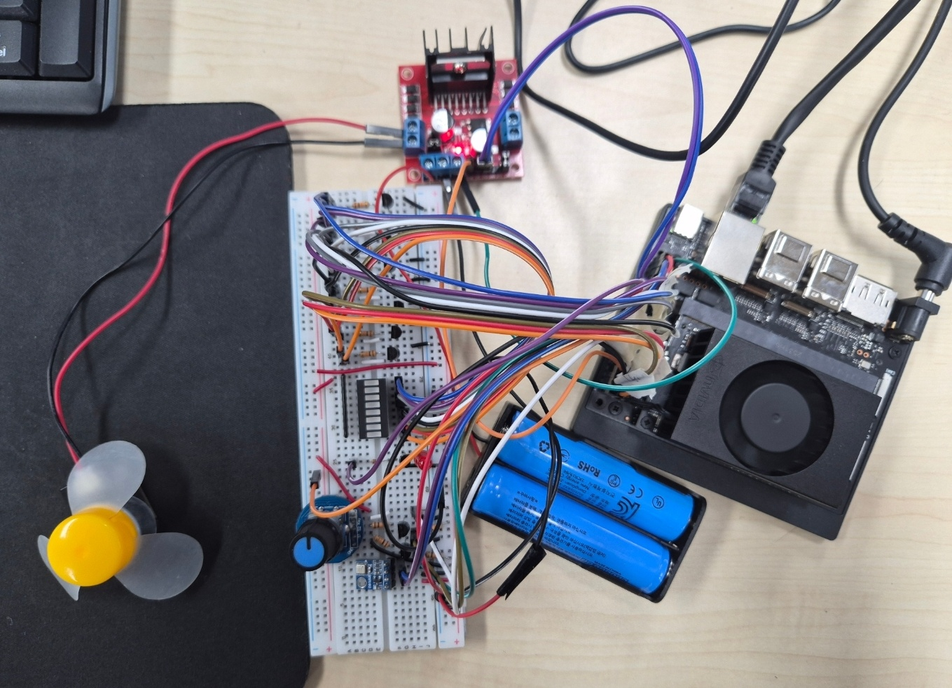
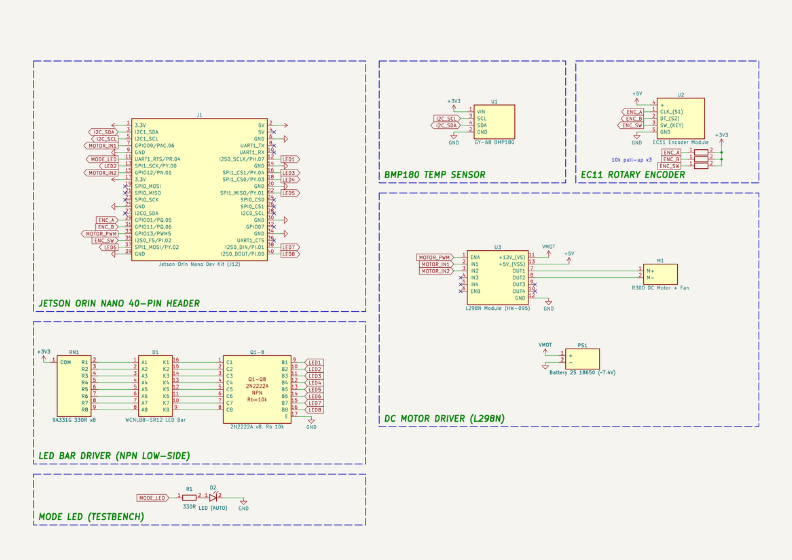
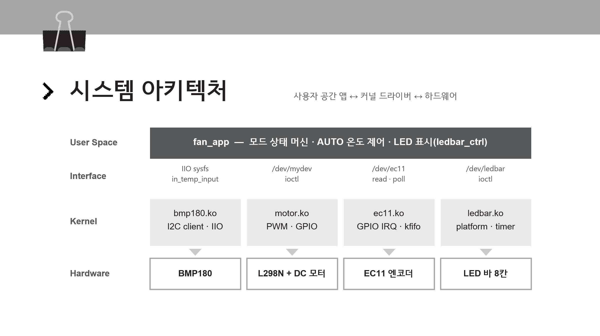

# Smart Fan — 커널 드라이버 기반 온도 감시 · 냉각 제어

> 대한상공회의소 서울기술교육센터 AI 시스템반도체 SW개발자 과정 · Linux 디바이스 드라이버 팀 프로젝트

| | |
|---|---|
| 📅 **기간 · 인원** | 2026.10.08 ~ 2026.10.13 · 4인 팀 (고지현 · 박서희 · 이규현 · 이호윤) |
| 🙋 **담당 (이규현)** | LED 바 커널 드라이버 (`drivers/ledbar`) — GPIO 배열 제어, 커널 타이머 애니메이션, `ioctl` · sysfs 인터페이스, 앱 표시 로직 `ledbar_ctrl` |
| 🛠️ **사용 기술** | C · Linux Kernel Module · Device Tree Overlay · I2C / IIO · PWM · GPIO IRQ · kfifo · mutex / spinlock |
| 📈 **결과** | 직접 작성한 커널 드라이버 4종(BMP180 · DC 모터 · EC11 · LED 바)으로 WAIT · AUTO · MANUAL 3가지 모드 통합 동작 확인 |

Jetson Orin Nano에서 온도 센서, 모터, 엔코더, LED 바를 모두 **리눅스 커널 드라이버로 직접 작성**하고,
사용자 공간 앱 `fan_app`이 표준 인터페이스(IIO · ioctl · poll)로만 하드웨어에 접근해 온도에 따라 풍량을 조절하는 스마트 선풍기입니다.

<p align="center">
  
  
</p>
<p align="center">실제 장치 · 회로도</p>

📑 [발표자료 (PDF)](docs/presentation/Smart_Fan_Linux_Driver_발표자료.pdf)

## 시연 영상

WAIT에서 시작 → 클릭으로 MANUAL(노브로 풍량 조절) → 클릭으로 AUTO(센서를 손으로 데우면 풍량 · LED 증가) → 2초 길게 눌러 WAIT

<table>
  <tr><th>통합 동작 시연</th></tr>
  <tr><td><video src="https://github.com/user-attachments/assets/e559106e-2e17-45d3-81c9-7cc68af98763" width="100%" controls muted></video></td></tr>
</table>

## 하드웨어 구성

| 부품 | 역할 | 연결 (Jetson 40핀 헤더) |
|---|---|---|
| BMP180 (GY-68) | 실내 온도 측정 | I2C 버스 7 · 핀 3 (SDA) / 5 (SCL) |
| R300 DC 모터 + L298N | 풍량 (PWM 1 kHz) | 핀 33 (PWM) · 7 (IN1) / 15 (IN2) |
| EC11 로터리 엔코더 | 모드 전환 · 풍량 조절 | 핀 29 (S1) / 31 (S2) / 35 (SW) |
| 8칸 LED 바 + 330Ω × 8 | 온도 · 풍량 표시 | 핀 12 · 13 · 16 · 18 · 22 · 37 · 38 · 40 |
| Jetson Orin Nano Developer Kit | 메인 보드 | JetPack 6 (L4T R36.5, Linux 5.15) |

## 시스템 구조

<p align="center"></p>

| 드라이버 | 커널 인터페이스 | 앱 접근 | 핵심 구현 |
|---|---|---|---|
| **BMP180** | I2C client + IIO | sysfs `in_temp_input` (m°C) | Chip ID(0x55) 확인, 보정계수 22바이트 읽기, 데이터시트 보정식으로 온도 계산, mutex로 측정 순서 보호 |
| **DC Motor** | platform driver + miscdevice | `/dev/mydev` `ioctl(SET_PWM)` | DT의 `pwms` · `in1/in2-gpios` 획득, PWM 1 kHz duty 0 ~ 100%, close · remove 시 모터 정지 |
| **EC11** | platform driver + cdev, GPIO IRQ | `/dev/ec11` `read` · `poll` | 쿼드러처 디코딩 + 디텐트 확정으로 떨림 제거, 20ms 디바운스 · 2s 롱프레스 타이머, kfifo(64칸) 이벤트 큐 |
| **LED Bar** | platform driver + miscdevice | `/dev/ledbar` `ioctl` · sysfs | `gpiod_get_array`로 8칸 한 번에 갱신, 커널 타이머 애니메이션(WAVE · BLINK · PROGRESS), 모듈 해제 시 자동 소등 |

### 동작 모드

| 모드 | 동작 | LED 바 |
|---|---|---|
| WAIT | 모터 정지 (duty 0%) | 전부 소등 |
| AUTO | 1초마다 온도 측정, 22°C 이상 ON / 20°C 미만 OFF, 22 → 32°C 구간 duty 40 → 100% | 온도 (경계 ±0.2°C 히스테리시스) |
| MANUAL | 노브 1칸 = duty ±5% (0 ~ 100%) | 풍량 (duty × 8 / 100, 올림) |

짧게 클릭하면 AUTO ↔ MANUAL 전환(WAIT에서는 직전 모드로 복귀), 2초 길게 누르면 어느 모드에서든 WAIT로 갑니다.

### 동기화 선택

| 드라이버 | 잠금 | 이유 |
|---|---|---|
| bmp180 · dc_motor | mutex | I2C 전송 대기 · ioctl처럼 sleep 가능한 프로세스 문맥 |
| ec11 · ledbar | spinlock_irqsave | ISR · 커널 타이머(인터럽트 문맥)와 read · ioctl이 같은 데이터를 공유 |

## 트러블슈팅

| 문제 | 원인 | 해결 |
|---|---|---|
| GPIO에 값을 써도 LED가 안 켜짐 | JetPack 6에서 헤더 핀이 tristate(출력 꺼짐)로 부팅 | `pinconf-groups`로 확인 후 jetson-io로 GPIO 설정 |
| DT 오버레이가 적용되지 않음 | 보드 compatible이 `p3767-0005-super`로 목록과 불일치 | compatible 수정, 개발 중에는 gpiod lookup table로 우회 |
| 엔코더 S1 · S2 신호가 읽히지 않음 | 10kΩ 풀업이 약해 NPN 반전단의 HIGH 레벨 미확보 | 풀업을 330Ω으로 교체해 정상 동작 확인 |
| 온도 경계에서 LED 바 깜빡임 | 칸 경계 온도에서 칸 수가 오르내림 | ±0.2°C 히스테리시스 적용 |

## 폴더 구조

```
Thermal_Fan_Driver/
├── drivers/
│   ├── bmp180/      I2C 온도 센서 IIO 드라이버 + DT 오버레이
│   ├── dc_motor/    PWM · GPIO 모터 드라이버 + DT 오버레이 + 단독 테스트(apptest)
│   ├── ec11/        로터리 엔코더 인터럽트 드라이버 + DT 오버레이
│   └── ledbar/      LED 바 드라이버 + DT 오버레이 + 앱 표시 로직(ledbar_ctrl)
├── Application/     fan_app (poll 기반 이벤트 루프, WAIT / AUTO / MANUAL)
├── Testbench/       드라이버별 단독 테스트 앱
└── docs/            발표자료 PDF, 사진, 시연 영상
```

## 결과와 발전 방향

- 커널 드라이버 4종을 직접 작성하고, 드라이버별 단독 테스트 앱으로 따로 검증한 뒤 `fan_app`에서 통합했습니다.
- 앱은 표준 인터페이스(IIO · ioctl · poll)로만 하드웨어에 접근해, 제어 정책(앱)과 장치 제어(드라이버)를 분리했습니다.
- 발전 방향: 남은 GPIO 번호 하드코딩을 디바이스 트리 기반으로 전환, 꺼짐 예약 · 자연풍 모드, 습도 센서를 더한 불쾌지수 기반 제어.
