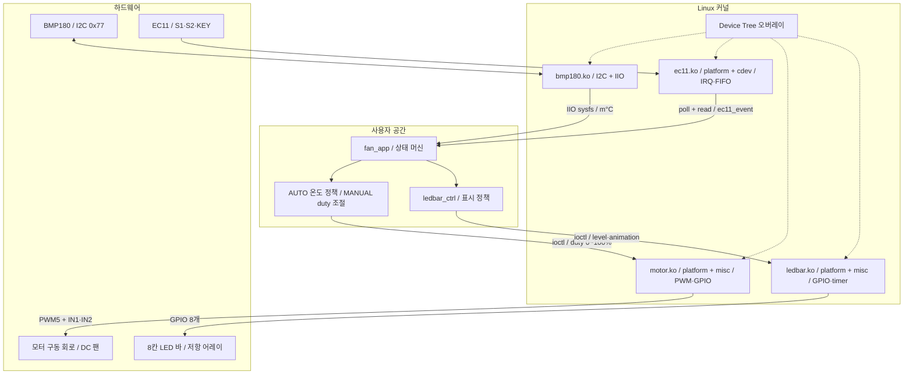
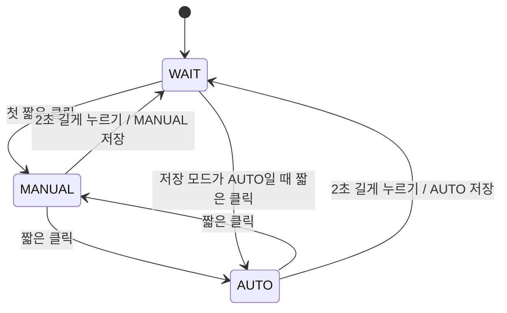

# BMP180 기반 스마트 팬 — Linux Device Driver Project

NVIDIA Jetson Orin Nano에서 BMP180 온도 센서, EC11 로터리 엔코더, DC 모터, 8칸 LED 바를 Linux 커널 드라이버와 사용자 공간 앱으로 통합한 프로젝트입니다. 온도에 따른 자동 운전과 노브를 이용한 수동 풍량 제어를 제공하며, Device Tree에 하드웨어 자원을 기술하고 커널과 앱의 역할을 분리합니다.

| 항목 | 기준 |
|---|---|
| 저장소 | [Kyuhyeon34/linux_driver_project](https://github.com/Kyuhyeon34/linux_driver_project) |
| 대상 브랜치 | [dev/kjh](https://github.com/Kyuhyeon34/linux_driver_project/tree/dev/kjh) |
| 확인 커밋 | [24e1113cd51640bfdc38e9ee8ac909a5dd2d5dc3](https://github.com/Kyuhyeon34/linux_driver_project/commit/24e1113cd51640bfdc38e9ee8ac909a5dd2d5dc3) |
| 소스 확인일 | 2026-10-13 |
| 개발 대상 | Jetson Orin Nano / JetPack 6 계열 |
| 기존 LED 문서의 환경 | L4T R36.5, Linux 5.15. 모든 릴리스에서 검증되었다는 뜻은 아님 |

> **길게 누르기 기준은 2초(2000ms)**입니다. 기존 EC11/Testbench README에는 3초 또는 long_press_ms=3000 안내가 남아 있습니다. 이 문서는 현재 요청과 드라이버 기본값에 맞춰 2000ms를 사용합니다.
>
> **모터의 최종 DT 적용 후 실제 PWM·회전·정지 기능 테스트는 확인되지 않았습니다.** 네 드라이버의 DT 구현 확인과 전체 실기 검증 완료를 구분합니다.

## 목차

- [1. 프로젝트 개요](#1-프로젝트-개요)
- [2. 시스템 아키텍처](#2-시스템-아키텍처)
- [3. 하드웨어 핀 맵](#3-하드웨어-핀-맵)
- [4. 네 커널 드라이버와 DT 매칭](#4-네-커널-드라이버와-dt-매칭)
- [5. 커널–사용자 공간 인터페이스](#5-커널사용자-공간-인터페이스)
- [6. WAIT / AUTO / MANUAL 로직](#6-wait--auto--manual-로직)
- [7. 빌드·설치·실행](#7-빌드설치실행)
- [8. 테스트 명령·결과·검증 상태](#8-테스트-명령결과검증-상태)
- [9. 문제 해결](#9-문제-해결)
- [10. 개발 과제와 남은 작업](#10-개발-과제와-남은-작업)
- [11. 저장소 구조](#11-저장소-구조)
- [12. 상세 문서와 근거](#12-상세-문서와-근거)

## 1. 프로젝트 개요

| 계층 | 역할 |
|---|---|
| 하드웨어 | 온도·기압 측정, 회전·버튼 입력, 모터 구동, LED 표시 |
| Device Tree | I2C 주소, GPIO 연결·극성, PWM 컨트롤러·주기, compatible 기술 |
| 커널 | 센서 보정 및 IIO 등록, IRQ 입력 이벤트, GPIO·PWM 출력, 장치 인터페이스 제공 |
| 사용자 공간 | 모드 전환, 온도 기반 duty 계산, 수동 풍량, LED 표시 정책 |

실제 모터 ioctl을 호출하는 통합 앱은 **Application/fan_app**입니다. Testbench/fan_ctrl은 EC11·LED 통합 시험용이며 모터 적용 콜백에 TODO가 남아 있습니다. 시험 앱에서 duty가 변한다고 실제 모터 연동이 완료된 것은 아닙니다.

네 드라이버 모두 DT 매칭 코드가 있습니다. LED에는 nodt=1 대체 시험 경로도 있으므로, DT 기반 구현과 네 장치 DT 동시 적용 성공을 별도로 기록합니다.

## 2. 시스템 아키텍처



센서값은 IIO sysfs, 입력은 문자 장치 이벤트, 출력은 ioctl로 전달합니다. BMP180 압력 채널도 구현되어 있지만 현재 팬 앱은 온도만 사용합니다. LED 애니메이션은 커널 타이머가 수행합니다.

## 3. 하드웨어 핀 맵

### 번호 체계

배선은 **Jetson 40핀 헤더의 물리 핀 번호**를 기준으로 합니다. DT GPIO 지정값과 런타임 gpiochip 라인 번호는 서로 다릅니다. LED1은 헤더 12번, PH.07, DT 지정값 63, 기존 실측 gpiochip0 라인 50입니다.

신호 핀은 저장소 DTS와 주석으로 확인했습니다. BMP180의 헤더 3/5번 I2C 버스 7 연결은 [NVIDIA 개발자 포럼의 Orin Nano 안내](https://forums.developer.nvidia.com/t/orin-nano-and-i2c/251902)로 보완했습니다. 실제 I2C 버스 번호와 노드 경로는 대상 시스템에서 대조합니다.

### 전체 신호 연결

| 장치 / 신호 | 헤더 물리 핀 | SoC 핀 / 기능 | DTS 지정 / 속성 | 극성·비고 |
|---|---:|---|---|---|
| BMP180 SDA | 3 | I2C SDA, 버스 7 기준 | /bus@0/i2c@c250000, reg=&lt;0x77&gt; | I2C 데이터 |
| BMP180 SCL | 5 | I2C SCL, 버스 7 기준 | 위 I2C 부모 노드 | I2C 클록 |
| EC11 S1 / A | 29 | PQ.05 | a-gpios=&lt;&amp;gpio 125 1&gt; | active-low |
| EC11 S2 / B | 31 | PQ.06 | b-gpios=&lt;&amp;gpio 126 1&gt; | active-low |
| EC11 KEY | 35 | PI.02 | key-gpios=&lt;&amp;gpio 66 1&gt; | active-low, 논리 1=눌림 |
| 모터 구동 회로 IN1 | 7 | PAC.06 | in1-gpios=&lt;&amp;gpio 166 0&gt; | active-high |
| 모터 구동 회로 IN2 | 15 | PN.01 | in2-gpios=&lt;&amp;gpio 105 0&gt; | active-high |
| 모터 PWM / enable 입력 | 33 | PWM5 | pwms=&lt;&amp;pwm5 0 1000000&gt; | 채널 0, 1ms, 1kHz |
| LED1 / 맨 아래 | 12 | PH.07 | &lt;&amp;gpio 63 0&gt; | active-high, bit0 |
| LED2 | 13 | PY.00 | &lt;&amp;gpio 144 0&gt; | active-high, bit1 |
| LED3 | 16 | PY.04 | &lt;&amp;gpio 148 0&gt; | active-high, bit2 |
| LED4 | 18 | PY.03 | &lt;&amp;gpio 147 0&gt; | active-high, bit3 |
| LED5 | 22 | PY.01 | &lt;&amp;gpio 145 0&gt; | active-high, bit4 |
| LED6 | 37 | PY.02 | &lt;&amp;gpio 146 0&gt; | active-high, bit5 |
| LED7 | 38 | PI.01 | &lt;&amp;gpio 65 0&gt; | active-high, bit6 |
| LED8 / 맨 위 | 40 | PI.00 | &lt;&amp;gpio 64 0&gt; | active-high, bit7 |
| 선택적 모드 LED | 11 | PR.04 | fan_ctrl 기본 gpiochip0 line=112 | Testbench 전용, fan_app에는 제어 코드 없음 |

EC11 DT는 S1/S2 반전을 active-low로 표현합니다. 과거 비-DT 코드에는 NPN 반전단 설명이 있으므로 실제 회로가 직접 연결인지 반전 회로인지 확인합니다. 전기적 입력 극성과 회전 방향 보정은 별개입니다.

### 전원·접지·저항 연결

저장소에는 완전한 회로도, 모터 구동 보드 모델·전원 정격, 모든 전원 핀의 실측 기록이 없습니다. 아래는 연결 기준과 미확인 범위를 함께 정리한 것입니다.

| 연결 | 기준 / 확인 사항 |
|---|---|
| BMP180 VCC/VDD | 실제 센서 보드 정격 확인. 3.3V 사용 가능 보드는 헤더 1/17번을 전원 후보로 사용할 수 있음. 실제 사용 핀은 미기록 |
| BMP180·EC11·모터 제어 회로 GND | Jetson GND와 공통 기준 연결. 예: 헤더 6번. 실제 사용 핀은 미기록 |
| EC11 전원·반전단 | 모듈 정격·풀업·NPN 반전단 유무 확인. Jetson 입력에 5V 신호 직접 연결 금지 |
| 모터 전원·출력 | 별도 모터 구동 회로 사용. 구동 보드의 입력 규격, 전원 정격, 모터 출력 단자 배선은 실기 확인 필요 |
| LED 애노드 | Jetson GPIO → LED 애노드(+) |
| LED 캐소드·저항 | LED 캐소드(−) → 9A331G 2~9번, 9A331G 1번(점 표시 공통) → GND. 개별 저항 핀 순서는 실제 배선 확인 |

기존 LED 문서의 nodt 라인 순서는 다음과 같습니다.

```text
LED1~8 gpiochip0 라인: 50,122,126,125,123,124,52,51
물리 헤더 핀:          12,13,16,18,22,37,38,40
```

이 번호를 DT 지정값 63/144/148/... 대신 사용하지 않습니다. gpiodetect, gpioinfo, gpiofind로 **핀 이름**을 대조합니다. 모터를 GPIO 핀에 직접 연결하지 않으며 LED에는 전류 제한 저항을 사용합니다.

## 4. 네 커널 드라이버와 DT 매칭

| 모듈 | 등록 방식 / 드라이버 이름 | 장치 compatible | DT 자원 | 사용자 인터페이스 |
|---|---|---|---|---|
| bmp180.ko | I2C driver / bmp180_custom | custom,bmp180 | I2C 부모 노드, reg=0x77 | IIO sysfs |
| ec11.ko | platform driver + cdev / ec11 | smartfan,ec11 | a-gpios, b-gpios, key-gpios | /dev/ec11 |
| motor.ko | platform driver + misc / smartfan-motor | smartfan,dc-motor | in1-gpios, in2-gpios, pwms, pwm-names="motor" | /dev/mydev |
| ledbar.ko | platform driver + misc / ledbar | team,ledbar | led-gpios 배열, 선택적 pinctrl | /dev/ledbar, platform sysfs |

각 드라이버는 of_match_table 및 MODULE_DEVICE_TABLE(of, ...)을 제공합니다. compatible 일치, 자원 획득, probe 성공 이후에 인터페이스가 생깁니다. **lsmod에 이름이 보이는 것만으로 바인딩 성공을 판정하지 않습니다.**

**보드 compatible과 장치 compatible은 다릅니다.** BMP180/EC11/모터/LED simple 오버레이의 루트 compatible은 nvidia,p3768-0000+p3767-0005-super입니다. LED full 오버레이에는 여러 비-super 문자열이 있지만 이 super 문자열은 없습니다. 실제 /proc/device-tree/compatible과 비교해야 합니다.

### BMP180 — I2C / IIO

- probe에서 I2C_FUNC_I2C, 0xD0의 chip ID 0x55, 보정 계수 블록을 검사합니다.
- 0xAA부터 22바이트를 읽어 11개 계수를 저장합니다. AC4/AC5/AC6는 unsigned, 나머지는 signed입니다.
- 레지스터 주소 쓰기와 데이터 읽기를 한 번의 i2c_transfer로 요청합니다. 부분 전송은 -EIO로 처리합니다.
- 0xF4에 온도 변환 명령 0x2E를 쓰고 5~6ms 대기한 뒤 0xF6부터 UT를 읽습니다.
- 64비트 중간 계산, 분모·범위 검사를 수행합니다. 변환 순서는 mutex로 보호합니다.
- 온도 보정 0.1°C 결과를 m°C로 변환합니다. 압력은 온도에서 계산한 B5를 이용하며 kPa로 노출합니다.
- 기본 OSS=0, 현재 사용자 설정 인터페이스는 없습니다. 온도 −40~85°C, 압력 30000~110000Pa를 검사합니다.
- IIO 이름은 bmp180_custom, INDIO_DIRECT_MODE입니다. 버퍼 스트리밍 방식이 아닙니다.

### EC11 — IRQ / 이벤트 FIFO

- 현재 CONF_DT=1이므로 DT 노드가 필요합니다. 이전 비-DT lookup table은 활성 빌드 경로가 아닙니다.
- S1/S2 양쪽 에지 IRQ와 quadrature 전이 테이블로 방향을 판정합니다.
- 기본 steps_per_detent=4이며 1/2/4를 지원합니다. 디텐트에서 전이를 누적하여 접점 바운스의 왕복 변화를 상쇄합니다.
- KEY debounce 기본 20ms. 안정된 눌림 이후 long_press_ms=2000 타이머를 시작합니다.
- CLICK은 해제 시 발생하고 LONG_PRESS는 누르고 있는 동안 한 번 발생합니다. LONG 이후 해제 때 CLICK을 추가하지 않습니다.
- FIFO 64개, read 1회의 최대 반환 16개 이벤트. 포화 시 이벤트를 버리고 경고합니다.
- spinlock, wait queue, poll을 사용합니다. open 시 기존 FIFO를 비우므로 입력 소비 앱을 동시에 실행하지 않습니다.

### DC 모터 — GPIO / PWM consumer

- devm_gpiod_get으로 IN1/IN2를 LOW 상태로 받고 devm_pwm_get(dev, "motor")로 PWM을 받습니다.
- 코드에서도 주기를 1000000ns로 설정합니다. DT 주기만 변경해도 실제 주기가 따라 바뀌지는 않습니다.
- duty 1~100%: IN1=1, IN2=0, 정상 극성 PWM 활성화.
- duty 0%: PWM 비활성화, IN1/IN2=0.
- ioctl을 mutex로 보호하고 범위를 검사합니다. PWM 적용 실패 시 정지를 시도합니다.
- probe 초기화, 파일 close, remove에서 정지 경로가 있습니다.
- ABI는 duty 설정 하나이며 역회전·RPM 피드백·duty 조회는 구현되어 있지 않습니다.

**위 내용은 소스 확인 결과입니다. 최종 DT로 바인딩한 실제 보드의 PWM 파형·회전·정지 검증은 대기 상태입니다.**

### LED 바 — GPIO 배열 / timer

- devm_gpiod_get_array로 1~8개 LED GPIO를 획득합니다.
- 타이머 문맥에서 출력하므로 sleep 가능한 GPIO 컨트롤러는 거부합니다.
- 레벨·비트 패턴·BLINK/WAVE/PROGRESS를 지원합니다. 기본 주기는 각각 500/60/375ms입니다.
- nodt=1은 GPIO lookup table과 platform device를 직접 만드는 대체 시험 경로입니다.
- remove/shutdown에서 타이머를 종료하고 소등합니다.
- full 오버레이는 pinctrl의 tristate/open-drain 등을 설정합니다. simple 오버레이는 이 설정이 없으므로 별도 핀 설정을 확인합니다.

PROGRESS 기본 8×375ms=3초는 **독립 LED 애니메이션 시간**입니다. EC11 길게 누르기 2초와 동일한 설정이 아니며 현재 fan_app은 버튼 누름 진행 표시를 연결하지 않습니다.

## 5. 커널–사용자 공간 인터페이스

| 장치 | API | 데이터 / 의미 |
|---|---|---|
| BMP180 | in_temp_input 읽기 | 정수 m°C, 예: 25000 → 25.0°C |
| BMP180 | in_pressure_input 읽기 | kPa 소수 표기, 예: 101.325000 → 101325Pa |
| EC11 | read / poll | struct ec11_event 배열 / FIFO 읽기 가능 상태 |
| EC11 | EC11_IOCTL_GET_COUNT | int 누적 카운트 |
| EC11 | EC11_IOCTL_RESET_COUNT | 카운트·회전 누적값 초기화 |
| 모터 | MY_IOCTL_CMD_SET_PWM | __u32 포인터, 0~100, _IOW('M',0,__u32) |
| LED | LEDBAR_SET_LEVEL | __s32 포인터, 0~8칸 |
| LED | LEDBAR_SET_PATTERN | __u8 포인터, bit0=LED1 |
| LED | LEDBAR_SET_ANIM | struct ledbar_anim: 종류·주기 |
| LED | LEDBAR_GET_STATE | struct ledbar_state: 목표·현재 패턴, 레벨, 애니메이션 등 |

위 숫자는 **단위 설명 예시이며 실측 결과가 아닙니다.**

```c
struct ec11_event {
    int type;   /* ROTATE=1, CLICK=2, LONG_PRESS=3, STATE=4 */
    int delta;  /* ROTATE: +1 또는 -1 */
    int count;  /* 발생 시점의 누적 카운트 */
    int state;  /* bit0 S1, bit1 S2, bit2 KEY(1=눌림) */
};

/* 모터에는 정수 자체가 아니라 포인터를 전달 */
__u32 duty = 40;
ioctl(motor_fd, MY_IOCTL_CMD_SET_PWM, &duty);
```

공유 헤더를 커널과 앱에서 함께 사용합니다. EC11 이벤트는 바이너리 레코드이므로 cat /dev/ec11 대신 테스트 앱을 사용합니다.

### IIO 번호 확인

fan_app.h의 TEMP_PATH는 iio:device0/in_temp_input으로 고정되어 있습니다. 탐색 순서에 따라 번호가 달라질 수 있습니다.

```bash
for d in /sys/bus/iio/devices/iio:device*; do
    printf '%s: ' "$d"
    cat "$d/name"
done
```

bmp180_custom이 다른 번호라면 Application/fan_app.h의 TEMP_PATH를 수정하고 앱을 재빌드합니다. 현재 센서 경로를 지정하는 CLI 옵션은 없습니다.

### LED 텍스트 및 sysfs

```bash
printf '5\n' | sudo tee /dev/ledbar
printf 'p 0xA5\n' | sudo tee /dev/ledbar
printf 'blink 300\n' | sudo tee /dev/ledbar
printf 'wave\n' | sudo tee /dev/ledbar
printf 'progress\n' | sudo tee /dev/ledbar
printf 'stop\n' | sudo tee /dev/ledbar
cat /dev/ledbar
printf '0\n' | sudo tee /dev/ledbar
```

stop/none/off는 애니메이션 NONE의 별칭으로 기본 패턴을 표시합니다. **소등에는 레벨 0을 사용합니다.** platform sysfs에는 level, pattern, anim 속성이 있습니다. nodt 경로는 /sys/devices/platform/ledbar/이며 DT 경로는 실제 platform 장치 위치를 확인합니다.

## 6. WAIT / AUTO / MANUAL 로직

### 모드 전환



| 상태 / 입력 | 동작 |
|---|---|
| 앱 시작 | WAIT, 모터 0%, 저장 모드 MANUAL, 수동 duty 0% |
| WAIT의 짧은 클릭 | 저장 모드 복귀. 최초에는 MANUAL |
| AUTO/MANUAL의 짧은 클릭 | AUTO ↔ MANUAL |
| AUTO/MANUAL의 2초 길게 누르기 | 현재 모드 저장 후 WAIT, 모터·LED 소등 |
| WAIT의 길게 누르기 | 상태 유지 |
| MANUAL 회전 | manual_duty += delta × step, 0~100% 제한 |
| AUTO/WAIT 회전 | 회전 카운터 갱신, 수동 duty 변경 없음 |
| SIGINT/SIGTERM | 루프 종료 후 모터 0%, LED 소등, 장치 close |

WAIT는 앱이 실행 중인 출력 정지 상태입니다. MANUAL duty는 WAIT 왕복과 AUTO 전환 과정에서 유지됩니다. 최초 MANUAL 진입 시 0%이므로 회전하여 duty를 올립니다.

기본 회전 단위는 5%, 앱 ROTATE_REVERSED=1입니다. -r은 앱 반전을 토글합니다. 드라이버 reverse 파라미터도 별도로 있으므로 이중 보정을 피하고 적용 값을 기록합니다.

### AUTO 정책

AUTO는 약 1초 간격으로 온도를 읽고 EC11 poll은 최대 100ms씩 대기합니다. 이는 정확한 실시간 주기·입력 지연 보장값이 아닙니다.

- OFF 상태에서 22.0°C 이상이면 ON.
- ON 상태에서 20.0°C 미만이면 OFF. 정확히 20.0°C에서는 ON 유지.
- ON 상태의 22.0°C 이하는 40%, 32.0°C 이상은 100%.
- 22~32°C 구간은 정수 계산: duty = 40 + (온도_mC − 22000) × 60 / 10000.

| 온도 | 직전 AUTO 상태 | 예상 duty |
|---:|---|---:|
| 19.9°C | ON/OFF 무관 | 0% |
| 20.0°C | OFF | 0% |
| 20.0°C | ON | 40% |
| 22.0°C | OFF | 40% |
| 25.0°C | ON | 58% |
| 27.0°C | ON | 70% |
| 32.0°C | ON | 100% |

표는 **소스 계산식 예상값이며 모터 실측 결과가 아닙니다.** auto_on은 정상 모드 전환만으로 항상 초기화되지는 않으며 AUTO 복귀 시 새 온도를 읽습니다.

센서 읽기 실패·범위 오류 시 temp_valid=false, auto_on=false로 만들고 AUTO 출력은 0%입니다. 이후 샘플에서 재시도합니다.

### LED 표시

| 모드 | 표시 |
|---|---|
| WAIT | 0칸 |
| MANUAL | FAN_LEVEL=(duty×8+99)/100, 0%=0칸, 100%=8칸 |
| AUTO | 21°C부터 1칸, 27°C 구간 7칸, 28°C 이상 8칸. 경계 ±0.2°C에서 이전 표시 유지 |
| WAIT → 운전 | WAVE 한 번 요청 후 목표 패턴 복귀. 후속 레벨 변경이 WAVE를 중단할 수 있음 |

AUTO LED는 온도 표시이므로 모터 duty와 일대일 대응하지 않습니다. 21°C에서 모터 OFF인데 LED가 켜질 수 있습니다. 온도 읽기 실패 시 TEMP가 마지막 정상값으로 유지되어 LED도 이전 온도를 표시할 수 있습니다.

LED 초기화 실패는 경고 후 계속 실행하지만 모터/EC11 open 실패는 앱 시작 실패입니다.

## 7. 빌드·설치·실행

명령은 **대상 Jetson Linux 터미널에서 저장소 루트를 기준으로** 실행합니다. 문서 작성 환경에서 커널 빌드·설치를 실행한 결과는 아닙니다.

### 7.1 환경 준비

```bash
git clone --branch dev/kjh --single-branch \
    https://github.com/Kyuhyeon34/linux_driver_project.git
cd linux_driver_project
git rev-parse HEAD
uname -r
cat /etc/nv_tegra_release
tr '\0' '\n' < /proc/device-tree/compatible

sudo apt update
sudo apt install build-essential device-tree-compiler gpiod i2c-tools \
    nvidia-l4t-kernel-headers
ls -ld "/lib/modules/$(uname -r)/build"
```

문서 재현 기준은 상단 커밋입니다. 브랜치 HEAD 변경 시 차이를 확인합니다. 실행 커널과 헤더 버전을 맞추고 저장소에 포함된 .ko와 실행 바이너리는 재빌드합니다.

### 7.2 빌드

```bash
make -C drivers/bmp180
make -C drivers/ec11
make -C drivers/ledbar
make -C drivers/dc_motor modules
make -C drivers/dc_motor apptest APP_CC=cc

make -C Application
make -C Testbench
make -C Testbench sim
```

모터 Makefile의 all은 apptest도 만들고 기본 APP_CC=aarch64-linux-gnu-gcc입니다. 네이티브 Jetson에서는 APP_CC=cc를 지정합니다. Application은 ledbar_ctrl.c를 함께 빌드하고 -lm을 링크합니다.

교차 빌드는 호스트의 uname -r 헤더가 아닌 대상 Jetson 커널 build tree, ARCH, toolchain을 지정해야 합니다. 해당 환경은 이 문서에서 검증하지 않았습니다.

### 7.3 pinmux와 DTBO 생성

BMP180 I2C, 33번 PWM5, EC11 입력 GPIO, 방향·LED 출력 GPIO를 올바른 기능으로 설정합니다. LED 핀의 SPI/I2S 중복 사용을 확인합니다.

```bash
sudo /opt/nvidia/jetson-io/jetson-io.py
```

Jetson-IO는 개발 보드의 헤더 설정을 DTB에 반영하고 재부팅 후 적용합니다. [NVIDIA 헤더 설정 문서](https://docs.nvidia.com/jetson/archives/r36.4.3/DeveloperGuide/HR/ConfiguringTheJetsonExpansionHeaders.html)

```bash
dtc -@ -I dts -O dtb \
    -o drivers/bmp180/bmp180.dtbo drivers/bmp180/bmp180-overlay.dts
dtc -@ -I dts -O dtb \
    -o drivers/ec11/ec11.dtbo drivers/ec11/ec11-overlay.dts
dtc -@ -I dts -O dtb \
    -o drivers/dc_motor/motor.dtbo drivers/dc_motor/motor-overlay.dts

# 현재 super compatible을 가진 simple 버전, 별도 pinmux 확인 필요
dtc -@ -I dts -O dtb \
    -o drivers/ledbar/ledbar.dtbo drivers/ledbar/ledbar-simple-overlay.dts

# full 버전을 사용할 때는 보드 compatible 확인. 두 버전 동시 적용 금지
dtc -@ -I dts -O dtb \
    -o drivers/ledbar/ledbar-full.dtbo drivers/ledbar/ledbar-overlay.dts
```

make -C drivers/ledbar dtbo는 **full** 버전을 ledbar.dtbo로 만듭니다. 위 simple 산출물과 이름이 같으므로 혼동하지 않습니다.

dtc -@는 심볼 fixup을 생성하지만 base DTB에 gpio/pwm5, full 버전의 pinmux 참조 심볼이 있어야 적용됩니다. BMP180 target-path도 실제 DT와 대조합니다.

### 7.4 DTBO 설치·부팅 적용

```bash
sudo install -m 0644 drivers/bmp180/bmp180.dtbo /boot/bmp180.dtbo
sudo install -m 0644 drivers/ec11/ec11.dtbo /boot/ec11.dtbo
sudo install -m 0644 drivers/dc_motor/motor.dtbo /boot/motor.dtbo
sudo install -m 0644 drivers/ledbar/ledbar.dtbo /boot/ledbar.dtbo

sudo cp -a /boot/extlinux/extlinux.conf \
    "/boot/extlinux/extlinux.conf.bak.$(date +%Y%m%d-%H%M%S)"
sudo nano /boot/extlinux/extlinux.conf
```

실제 선택되는 LABEL 아래 기존 설정·pinmux 오버레이를 보존하고 필요한 파일을 합칩니다. R36 ExtLinux 구성 예시이며 **실기 성공 기록은 아닙니다.**

```text
    OVERLAYS /boot/bmp180.dtbo,/boot/ec11.dtbo,/boot/motor.dtbo,/boot/ledbar.dtbo
```

FDT가 지정되어 있으면 base DTB가 대상 보드용인지 확인합니다. 기존 Jetson-IO 설정을 덮어쓰지 않습니다. R36 OVERLAYS 사용은 [NVIDIA 개발자 포럼 사례](https://forums.developer.nvidia.com/t/enable-camera-sensor-connected-to-i2c-mux/294252)를 참고합니다. 오래된 U-Boot 문서의 FDTOVERLAYS 설정과 릴리스 확인 없이 섞지 않습니다.

```bash
sudo reboot

# 재부팅 후 실행 중인 DT 확인
test -d /proc/device-tree/bus@0/i2c@c250000/bmp180@77
test -d /proc/device-tree/ec11
test -d /proc/device-tree/motor
test -d /proc/device-tree/ledbar

tr '\0' '\n' < /proc/device-tree/bus@0/i2c@c250000/bmp180@77/compatible
tr '\0' '\n' < /proc/device-tree/ec11/compatible
tr '\0' '\n' < /proc/device-tree/motor/compatible
tr '\0' '\n' < /proc/device-tree/ledbar/compatible
sudo dtc -I fs -O dts -o /tmp/smartfan-running.dts /proc/device-tree
```

파일 복사만으로 적용 성공을 판정하지 않습니다. DT 노드 → compatible → 바인딩 → 인터페이스 → 실제 신호 순서로 확인합니다.

### 7.5 모듈 설치·depmod·로드

```bash
sudo install -d "/lib/modules/$(uname -r)/extra"
sudo install -m 0644 drivers/bmp180/bmp180.ko \
    drivers/ec11/ec11.ko drivers/dc_motor/motor.ko \
    drivers/ledbar/ledbar.ko "/lib/modules/$(uname -r)/extra/"
sudo depmod -a "$(uname -r)"

sudo modprobe bmp180
sudo modprobe ec11 long_press_ms=2000
sudo modprobe motor
sudo modprobe ledbar

lsmod | grep -E 'bmp180|ec11|motor|ledbar'
ls -l /dev/ec11 /dev/mydev /dev/ledbar
sudo dmesg | tail -n 100
cat /sys/module/ec11/parameters/long_press_ms
```

depmod는 의존성·별칭 정보를 갱신하며 DT 노드나 pinmux를 설정하지 않습니다. 현재 EC11·모터는 DT 없이 모듈만 로드하면 장치가 생성되지 않을 수 있습니다. 동적 장치 번호를 사용하므로 과거 모터 코드의 major 120을 따라 mknod하지 않습니다.

재부팅·자동 로드에서도 2초를 고정하려면:

```bash
printf 'options ec11 long_press_ms=2000\n' | \
    sudo tee /etc/modprobe.d/smartfan-ec11.conf
```

이미 로드된 값은 modprobe 재실행만으로 바뀌지 않습니다. 현재 파라미터는 쓰기 가능하므로 앱을 멈추고 노브를 누르지 않은 상태에서 수정할 수 있습니다.

```bash
printf '2000\n' | sudo tee /sys/module/ec11/parameters/long_press_ms
```

### 7.6 LED nodt 대체 시험

기존 LED README에는 DT 적용 후 /proc/device-tree/ledbar가 생성되지 않았고 **Jetson-IO + nodt=1로 동작했다는 기록**이 있습니다.

```bash
# 앱 종료 후, DT LED 장치와 중복 사용하지 않음
sudo modprobe -r ledbar
sudo modprobe ledbar nodt=1
# 설치 전 직접 로드:
# sudo insmod drivers/ledbar/ledbar.ko nodt=1
```

이 경로를 사용한 결과를 LED DT 통합 성공으로 기록하지 않습니다. full compatible 불일치는 조사 후보이며 기존 실패의 확정 원인은 아닙니다.

### 7.7 앱 실행

```bash
sudo ./Application/fan_app
sudo ./Application/fan_app -s 5
sudo ./Application/fan_app -r
```

-s는 1~100% 회전 단위, -r은 앱 반전 토글입니다. WAIT로 시작하며 Ctrl+C로 종료합니다. fan_app, fan_ctrl, ec11_test를 동시에 실행하지 않습니다.

## 8. 테스트 명령·결과·검증 상태

### 8.1 판정 기준과 현재 결과

- **확인 — 소스:** 기준 커밋의 구현·설정을 직접 확인. 실행 성공을 뜻하지 않음.
- **기록 있음 — 기존 문서:** 저장소의 동작·실측 기록. 이번에 재실행하지 않음.
- **대기 — 실기:** 대상 보드 로그·측정 결과가 없어 성공 판정 보류.
- **문제 기록:** 기존 문서에 실패가 있으며 해결 여부 미확인.

| 항목 | 상태 | 근거 / 결과 |
|---|---|---|
| 네 드라이버 compatible·DT 자원 | 확인 — 소스 | DTS와 매칭 테이블 확인 |
| WAIT/AUTO/MANUAL·온도 계산식 | 확인 — 소스 | fan_app.c/.h 활성 코드 |
| EC11 2초 기본값 | 확인 — 소스 | long_press_ms=2000. 기존 3초 문서와 충돌 |
| LED nodt 출력 | 기록 있음 — 기존 문서 | Jetson-IO + nodt 동작 기록 |
| LED tristate/open-drain 문제 | 기록 있음 — 기존 문서 | LED DTS 주석의 R36.5 실측 설명 |
| LED full DT 적용 | 문제 기록 | 기존 README: ledbar DT 노드 미생성, 원인 미확인 |
| 현재 커밋 커널·앱 빌드 | 대기 — 실기 | 빌드 산출물 존재는 확인, 대상 환경 빌드 로그 없음 |
| BMP180 DT probe·온도·기압 실측 | 대기 — 실기 | IIO 구현은 확인, 실측 로그 없음 |
| EC11 DT 회전·클릭·2초 long-press | 대기 — 실기 | 시험 코드 존재, 현재 실기 로그 없음 |
| 모터 최종 DT·PWM·회전·정지 | **대기 — 실기** | **최종 DT 기능 테스트 확인되지 않음** |
| 네 장치 DT 동시 적용·fan_app | 대기 — 실기 | 전체 통합 완료를 입증하는 로그 없음 |

이전 대화에서 DT 매칭, 배선, 빌드, 앱 실행, 아키텍처와 검증 결과를 정리하자는 요청을 확인했습니다. 이번 대화 조회는 상세 답변·측정 로그를 참조 표시로만 반환하여 실기 성공 근거로 사용하지 않았습니다. 이 문서 작성 환경에서는 대상 Jetson 커널 빌드나 하드웨어 시험을 실행하지 않았습니다.

### 8.2 BMP180

```bash
i2cdetect -l
readlink -f /sys/bus/i2c/devices/7-0077/driver
sudo dmesg | grep -E 'BMP180|bmp180|Calibration'

# 이름을 확인한 실제 IIO 번호로 수정
cat /sys/bus/iio/devices/iio:device0/name
cat /sys/bus/iio/devices/iio:device0/in_temp_input
cat /sys/bus/iio/devices/iio:device0/in_pressure_input
```

예상 합격 조건: bmp180_custom 이름, chip ID·보정 로드·IIO 등록 로그, 온도 변화에 따른 갱신, 기준 센서와의 비교 기록.

주소 검색이 필요한 미바인딩 상태에서는 sudo i2cdetect -y 7 0x77 0x77을 사용할 수 있습니다. UU는 커널 드라이버 점유를 뜻하며 chip ID 검증의 대체 결과가 아닙니다. 활성 드라이버와 동시에 직접 레지스터 접근을 하지 않습니다.

### 8.3 EC11

```bash
cat /sys/module/ec11/parameters/long_press_ms
sudo ./Testbench/ec11_test E
# 모니터 종료 후 각각 실행
sudo ./Testbench/ec11_test I GET
sudo ./Testbench/ec11_test I RESET
sudo ./Testbench/ec11_test I GET
```

예상 합격 조건: CW/CCW와 카운트 변화, RESET 후 0, 해제 시 CLICK 1회, 안정된 눌림부터 약 2초 후 LONG 1회, LONG 이후 CLICK 없음. debounce·스케줄링 때문에 2.000초의 정밀 타이밍이라고 주장하지 않습니다. 모듈 로드 시 노브를 디텐트에서 정지시킵니다.

### 8.4 LED

```bash
sudo ./Testbench/ledbar_test demo
printf '0\n' | sudo tee /dev/ledbar
printf '8\n' | sudo tee /dev/ledbar
printf 'p 0xA5\n' | sudo tee /dev/ledbar
printf 'wave\n' | sudo tee /dev/ledbar
cat /dev/ledbar
sudo ./Testbench/fan_led_sim
```

예상 합격 조건: LED 순서, 0/8칸, 패턴 bit 순서, 애니메이션·복귀. 시뮬레이터는 표시 정책 시험이며 센서·모터 실제 통합의 증거가 아닙니다.

### 8.5 모터 최종 DT 기능 시험 — 미확인

```bash
readlink -f /sys/bus/platform/devices/motor/driver
ls -l /dev/mydev
sudo dmesg | grep -E 'Motor|PWM|smartfan'
sudo cat /sys/kernel/debug/pwm

# 각각 독립 실행. Enter를 누르면 close를 통해 정지
sudo ./drivers/dc_motor/apptest 0
sudo ./drivers/dc_motor/apptest 40
sudo ./drivers/dc_motor/apptest 70
sudo ./drivers/dc_motor/apptest 100
```

앞으로 확인할 합격 조건:

1. DT 노드가 smartfan-motor에 바인딩되고 /dev/mydev 생성.
2. 헤더 33번에서 약 1ms(1kHz) 주기, 요청 duty와 실제 파형 일치.
3. 운전 시 IN1=HIGH/IN2=LOW 및 실제 회전.
4. duty 0, Enter/close, 모듈 제거 시 실제 출력 정지.
5. 100 초과 입력 거부. PWM duty와 실제 RPM은 구분하여 기록.

**이 절은 시험 절차이며 성공 결과가 아닙니다. 모터 최종 DT 기능 테스트는 여전히 대기입니다.**

### 8.6 통합·오류 시험

```bash
sudo ./Application/fan_app -s 5
```

WAIT 0% → 클릭 MANUAL 0% → 회전 duty 증가 → 클릭 AUTO → 온도 기반 출력 → 2초 길게 누르기 WAIT → 클릭 이전 모드 복귀 → Ctrl+C 정지를 확인합니다.

AUTO에서는 22°C 이상 ON, 20°C 미만 OFF를 실제 온도·직전 상태·duty와 함께 기록합니다. 센서 오류 시험은 계획된 환경에서 통신 실패를 유도하여 오류 로그, AUTO 0%, 복구 후 재측정을 확인합니다. 센서 sysfs 값을 일반 파일처럼 덮어쓰지 않습니다.

코드의 일부 오류 루프 종료 경로는 최종 EXIT_SUCCESS를 반환하므로 종료 코드 0만으로 합격을 판정하지 않습니다.

### 8.7 결과 기록 양식

| 날짜 / 커밋 | JetPack·커널 | 항목 | 조건 | 실제 로그·파형 | 판정 |
|---|---|---|---|---|---|
| 미기록 | 미기록 | 모터 최종 DT | 0/40/70/100%, close 정지 | 미첨부 | 대기 |
| 미기록 | 미기록 | 네 장치 DT 통합 | fan_app 상태 전환 | 미첨부 | 대기 |

합격 갱신 시 실제 커밋, boot LABEL/DT, 모듈 파라미터, 명령·로그·측정 자료를 함께 남깁니다.

## 9. 문제 해결

| 증상 | 확인·조치 |
|---|---|
| Invalid module format | uname -r, 헤더 build 경로, modinfo의 vermagic 확인 후 재빌드 |
| 모듈은 있지만 /dev 없음 | DT 노드·compatible·status, 바인딩, probe 오류 확인. mknod로 해결하지 않음 |
| DTBO 복사 후 노드 없음 | 실제 boot LABEL, OVERLAYS, base DTB, 보드 compatible, 심볼 확인 |
| motor PWM 획득 실패 / probe defer | pwm5 provider·status, pwms, pwm-names, dmesg 확인 |
| PWM 상태는 정상인데 파형 없음 | 33번 pinmux·패드 확인. debugfs 값만으로 외부 파형 보장 불가 |
| GPIO 쓰는데 LED 안 켜짐 | tristate/open-drain, GPIO 기능, 극성·저항·접지 확인 |
| GPIO busy | 모듈·SPI/I2S·선택적 모드 LED의 점유 확인 |
| EC11 방향 반대 | 반전단·DT 극성 확인 후 앱 -r 또는 드라이버 reverse를 하나씩 보정 |
| 회전 튐 / 누락 | 접점·디텐트 초기 상태·steps_per_detent·FIFO full 확인 |
| 길게 누르기가 3초 | 로드 파라미터와 modprobe 설정 확인, 기존 3000 override 제거 |
| BMP180 read failed | IIO 번호, I2C 바인딩, 전원·주소·보정 오류 확인. AUTO는 0% |
| 센서 오류인데 LED 값 유지 | TEMP가 마지막 정상값을 유지하는 현재 구현. 오류 표시는 미구현 |
| 권한 오류 | 진단 시 sudo, 배포 시 장치별 udev/그룹 권한 설정 |
| fan_ctrl duty 변화에도 모터 정지 | 모터 콜백 TODO. 실제 출력은 fan_app/apptest로 검증 |
| 입력 이벤트 불규칙 | 다른 EC11 소비 앱 종료. 공유 FIFO 및 open 초기화 확인 |

```bash
gpiodetect
gpioinfo
sudo cat /sys/kernel/debug/pinctrl/2430000.pinmux/pinconf-groups | \
    grep -A4 -E 'soc_gpio41_ph7|spi3_sck_py0'
sudo dmesg | tail -n 100
```

debugfs·pinctrl 경로는 실제 커널에서 확인합니다. 기존 LED 문서의 출력 정상 조건은 tristate=0입니다.

## 10. 개발 과제와 남은 작업

| 과제 | 현재 접근 / 남은 작업 |
|---|---|
| 하드웨어 자원 분리 | DT descriptor·PWM consumer API 사용. base DT·pinmux 통합 시험 필요 |
| 센서 보정 | 계수 signed/unsigned 분리, 64비트 계산·범위 검사. 실제 기준계 비교 필요 |
| 접점 바운스 | quadrature 누적·디텐트·debounce·long-press 분리. 빠른 회전·장시간 시험 필요 |
| 경계 온도 흔들림 | 모터 22/20°C, LED ±0.2°C 히스테리시스 |
| 모터 정지 | 0%·close·remove 경로 구현. 최종 DT 파형·비정상 종료 시험 필요 |
| 출력 패드 | Jetson-IO 대체 경로·LED full pinctrl. DT 미적용 원인 확정 필요 |
| 문서 불일치 | 현재 2초 기준. 기존 EC11/Testbench의 3초 안내 수정은 별도 작업 |
| 앱 개선 | IIO 자동 탐색, 센서 오류 LED 표시, LED ioctl 오류 전달, 오류 종료 코드 |
| 시험 구분 | fan_ctrl TODO와 fan_app 실제 출력 구분. 네 장치 DT 동시 동작 로그 필요 |
| 저장소 관리 | .ko/.o/.cmd·실행 파일·backup 포함. 산출물 관리 방침 정비 가능 |

이 README 작성에서는 드라이버·DT·기존 상세 README를 변경하지 않았습니다. 남은 항목은 후속 작업이며 완료 사실이 아닙니다.

## 11. 저장소 구조

기준 커밋의 주요 소스 구조입니다. 반복되는 빌드 산출물·실행 바이너리는 축약했습니다.

```text
linux_driver_project/
├── README.md
├── Application/
│   ├── Makefile
│   ├── fan_app.c
│   ├── fan_app.h
│   └── fan_globals.h
├── Testbench/
│   ├── Makefile
│   ├── README.md
│   ├── README_legacy.md
│   ├── ec11_test.c
│   ├── ledbar_test.c
│   ├── fan_ctrl.c
│   ├── fan_state.c
│   ├── fan_state.h
│   └── fan_led_sim.c
└── drivers/
    ├── bmp180/
    │   ├── Makefile
    │   ├── bmp180.c
    │   ├── bmp180.h
    │   ├── bmp180-overlay.dts
    │   ├── current-jetson.dts
    │   └── *.bak / 빌드 산출물
    ├── dc_motor/
    │   ├── Makefile
    │   ├── motor.c
    │   ├── motor.h
    │   ├── motor_ioctl.h
    │   ├── motor-overlay.dts
    │   ├── apptest.c
    │   └── *.pre_dt / 빌드 산출물
    ├── ec11/
    │   ├── Makefile
    │   ├── README.md
    │   ├── ec11.c
    │   ├── ec11_ioctl.h
    │   ├── ec11-overlay.dts
    │   └── dt.txt
    ├── ledbar/
    │   ├── Makefile
    │   ├── README.md
    │   ├── ledbar.c
    │   ├── ledbar_ioctl.h
    │   ├── ledbar_ctrl.c
    │   ├── ledbar_ctrl.h
    │   ├── ledbar-overlay.dts
    │   └── ledbar-simple-overlay.dts
    └── merge_ec11_led/
        └── 이전 통합 빌드 산출물
```

앱은 Application/Makefile, 시험 앱은 Testbench/Makefile, 커널 모듈은 각 드라이버 Makefile로 빌드합니다. merge_ec11_led 산출물은 현재 소스의 대체 빌드 경로가 아닙니다.

## 12. 상세 문서와 근거

### 드라이버 README 및 시험 문서

- [EC11 README](https://github.com/Kyuhyeon34/linux_driver_project/blob/dev/kjh/drivers/ec11/README.md) — **3초 안내는 현재 2초 기준과 다름.**
- [LED 바 README](https://github.com/Kyuhyeon34/linux_driver_project/blob/dev/kjh/drivers/ledbar/README.md) — 배선·nodt 동작·DT 실패 기록.
- [Testbench README](https://github.com/Kyuhyeon34/linux_driver_project/blob/dev/kjh/Testbench/README.md) — 시험 앱 역할, 큐 충돌. **3000ms 예시는 현재 2000ms 적용.**
- [이전 통합 문서](https://github.com/Kyuhyeon34/linux_driver_project/blob/dev/kjh/Testbench/README_legacy.md) — 과거 구조·모드 LED.

기준 커밋에는 **BMP180과 DC 모터 폴더의 별도 README.md가 없습니다.** 존재하지 않는 README 링크 대신 실제 소스와 DT를 제공합니다.

### 기준 커밋으로 고정한 구현 근거

- [통합 앱](https://github.com/Kyuhyeon34/linux_driver_project/blob/24e1113cd51640bfdc38e9ee8ac909a5dd2d5dc3/Application/fan_app.c) · [정책 상수](https://github.com/Kyuhyeon34/linux_driver_project/blob/24e1113cd51640bfdc38e9ee8ac909a5dd2d5dc3/Application/fan_app.h) · [앱 빌드](https://github.com/Kyuhyeon34/linux_driver_project/blob/24e1113cd51640bfdc38e9ee8ac909a5dd2d5dc3/Application/Makefile)
- [BMP180 소스](https://github.com/Kyuhyeon34/linux_driver_project/blob/24e1113cd51640bfdc38e9ee8ac909a5dd2d5dc3/drivers/bmp180/bmp180.c) · [헤더](https://github.com/Kyuhyeon34/linux_driver_project/blob/24e1113cd51640bfdc38e9ee8ac909a5dd2d5dc3/drivers/bmp180/bmp180.h) · [DT](https://github.com/Kyuhyeon34/linux_driver_project/blob/24e1113cd51640bfdc38e9ee8ac909a5dd2d5dc3/drivers/bmp180/bmp180-overlay.dts)
- [모터 소스](https://github.com/Kyuhyeon34/linux_driver_project/blob/24e1113cd51640bfdc38e9ee8ac909a5dd2d5dc3/drivers/dc_motor/motor.c) · [ABI](https://github.com/Kyuhyeon34/linux_driver_project/blob/24e1113cd51640bfdc38e9ee8ac909a5dd2d5dc3/drivers/dc_motor/motor_ioctl.h) · [DT](https://github.com/Kyuhyeon34/linux_driver_project/blob/24e1113cd51640bfdc38e9ee8ac909a5dd2d5dc3/drivers/dc_motor/motor-overlay.dts) · [시험 앱](https://github.com/Kyuhyeon34/linux_driver_project/blob/24e1113cd51640bfdc38e9ee8ac909a5dd2d5dc3/drivers/dc_motor/apptest.c)
- [EC11 소스](https://github.com/Kyuhyeon34/linux_driver_project/blob/24e1113cd51640bfdc38e9ee8ac909a5dd2d5dc3/drivers/ec11/ec11.c) · [ABI](https://github.com/Kyuhyeon34/linux_driver_project/blob/24e1113cd51640bfdc38e9ee8ac909a5dd2d5dc3/drivers/ec11/ec11_ioctl.h) · [DT](https://github.com/Kyuhyeon34/linux_driver_project/blob/24e1113cd51640bfdc38e9ee8ac909a5dd2d5dc3/drivers/ec11/ec11-overlay.dts)
- [LED 소스](https://github.com/Kyuhyeon34/linux_driver_project/blob/24e1113cd51640bfdc38e9ee8ac909a5dd2d5dc3/drivers/ledbar/ledbar.c) · [표시 정책](https://github.com/Kyuhyeon34/linux_driver_project/blob/24e1113cd51640bfdc38e9ee8ac909a5dd2d5dc3/drivers/ledbar/ledbar_ctrl.c) · [ABI](https://github.com/Kyuhyeon34/linux_driver_project/blob/24e1113cd51640bfdc38e9ee8ac909a5dd2d5dc3/drivers/ledbar/ledbar_ioctl.h) · [full DT](https://github.com/Kyuhyeon34/linux_driver_project/blob/24e1113cd51640bfdc38e9ee8ac909a5dd2d5dc3/drivers/ledbar/ledbar-overlay.dts) · [simple DT](https://github.com/Kyuhyeon34/linux_driver_project/blob/24e1113cd51640bfdc38e9ee8ac909a5dd2d5dc3/drivers/ledbar/ledbar-simple-overlay.dts)
- [시험 코드 제한](https://github.com/Kyuhyeon34/linux_driver_project/blob/24e1113cd51640bfdc38e9ee8ac909a5dd2d5dc3/Testbench/README.md) · [기존 LED 결과](https://github.com/Kyuhyeon34/linux_driver_project/blob/24e1113cd51640bfdc38e9ee8ac909a5dd2d5dc3/drivers/ledbar/README.md)

동작 설명은 기준 커밋의 활성 코드 경로를 따릅니다. #if 0의 과거 코드와 오래된 주석을 현재 구현으로 취급하지 않았습니다.
